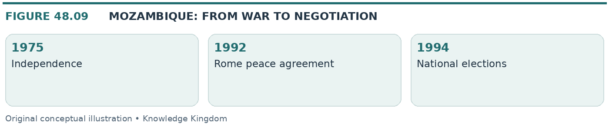

Мозамбик стана независим от Португалия през 1975 г. Правителството, водено от FRELIMO и бунтовническото движение RENAMO впоследствие води продължителна гражданска война, която е тясно свързана с регионалната политика на Южна Африка. RENAMO получи подкрепа от съседните режими на бяло-минорност, докато вътрешните спорове относно политическата власт и правителствените политики също оформиха конфликта. \[<a href="/048-civil-wars-and-fragile-states/sources/#source-22" class="cite">22</a>\]\[<a href="/048-civil-wars-and-fragile-states/sources/#source-23" class="cite">23</a>\] Нито едно изключително обяснение от Студената война, нито чисто домашна сметка са достатъчни.

Мирното споразумение, подписано в Рим на 4 октомври 1992 г., разглежда политическата конкуренция, гаранциите, хуманитарните въпроси и прехода от въоръжен конфликт. Организацията на обединените нации създаде ONUMOZ, за да подпомогне наблюдението на изпълнението. Процесът включваше избори и превръщането на бивши противници в участници в нова политическа рамка. Изпълнението се сблъска със значителни пречки и последвалите прояви на насилие в Мозамбик показват, че едно успешно споразумение за прекратяване на една война не имунизира държава срещу всички по-късни конфликти.

Най-полезният урок е институционален, а не празник. Преговарящите не само обявиха, че страните трябва да си имат доверие. Те създадоха разпоредби, които могат да бъдат наблюдавани и процедури, чрез които да се решават спорни въпроси. Международното участие имаше значение, но ефективността на споразумението все още зависеше от вътрешните решения. Мирният процес трябва да се разбира като началото на трудна връзка между бивши врагове, а не като снимка, направена в момента на подписването.

<figure class="figure" id="figure-48-9">

<figcaption>Фигура 48.9. Избрани политически етапи \[22\]\[23\]. <a class="figure-anchor" href="#figure-48-9" aria-label="Link to this figure">#</a></figcaption>
</figure>
