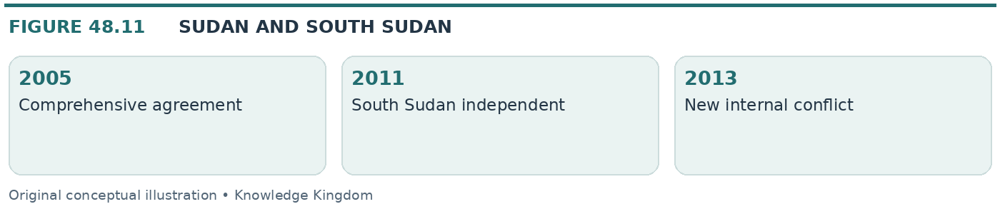

Судан претърпя продължителен вътрешен конфликт през десетилетията, заобикалящи независимостта и след това. Всеобхватното мирно споразумение от 2005 г. между суданското правителство и Движението за освобождение на народа на Судан създаде път към референдум за южна независимост. Южен Судан стана независима държава през юли 2011 г. Въпреки това през 2013 г. в новата страна избухна сериозен конфликт и през 2018 г. беше подписано мирно споразумение за съживяване. \[<a href="/048-civil-wars-and-fragile-states/sources/#source-33" class="cite">33</a>\]

Тези събития показват, че отцепването може да реши един спор за териториалните и политическите отношения между общностите, като същевременно остави други спорове нерешени. Независимостта създава нов набор от институции, които трябва да управляват публичните приходи, политическото представителство и разпределението на властта. Признаването от други държави не създава автоматично ефективни съдилища, служби или доверие сред националните политически групи.

През април 2023 г. в Судан започна отделен конфликт между Суданските въоръжени сили и силите за бърза подкрепа. Нейните опустошителни хуманитарни последици са документирани от агенциите на ООН, включително масово изместване и сериозно нарушаване на здравните и хранителните системи. \[<a href="/048-civil-wars-and-fragile-states/sources/#source-34" class="cite">34</a>\] Конфликтите в Судан и Южен Судан не трябва да се преплитат само защото страните споделят история. Трябва да се различават датите, правителствата, партиите и селищата. Примерът също така е предупреждение за третирането на създаването на държавата като по своята същност окончателно решение: съответният въпрос е дали институциите могат да се справят със следващия спор, без да се връщат към организираното насилие.

<figure class="figure" id="figure-48-11">

<figcaption>Фигура 48.11. Независимостта реши един териториален въпрос, а не всеки политически спор. <a class="figure-anchor" href="#figure-48-11" aria-label="Link to this figure">#</a></figcaption>
</figure>
