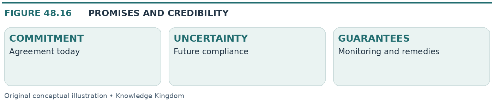

Представете си две измислени политически организации, които са съгласни с ново конституционно споразумение. И двамата публично обещават да спазват резултатите от бъдещите избори. И все пак всеки се опасява, че след като се откаже от предишната си принудителна сила, другият може да наруши споразумението. Обещание, което е искрено днес, може да бъде трудно да се приложи утре, ако политическият баланс се промени. Проблемът засяга надеждността на ангажиментите във времето, а не само личностите на преговарящите.

Изследванията на Барбара Уолтър относно гражданското военно селище подчертават, че бившите противници са изправени пред отличителни проблеми при прилагането на споразумения, защото те често трябва да се доверяват на институции, за които преди са се борили. Гаранцията от трета страна и изпълнимите политически договорености могат да помогнат за преодоляването на тези опасения. \[<a href="/048-civil-wars-and-fragile-states/sources/#source-42" class="cite">42</a>\] Това прозрение се свързва с нашето обсъждане на преговорите в глава 45: страните могат да предпочитат по принцип мирен резултат, но не са съгласни дали обещанията ще бъдат спазвани на практика.

Не всички гаранции са еднакво надеждни. Посредникът може да не разполага с правомощия или ресурси, за да гарантира спазването; конституционна разпоредба може да липсва независим съд; външният участник може да промени приоритетите си. Следователно подходящият въпрос не е само дали съществува гаранция, но и кой отговаря за нея, как се оценява съответствието и какви правни средства за защита съществуват, ако ангажиментите бъдат нарушени. Никоя гаранция не прави бъдещия мир сигурен. Целта е мирното политическо участие да стане по-надеждно от несигурните алтернативи.

<figure class="figure" id="figure-48-16">

<figcaption>Фигура 48.16. Проблемът с обвързването се отнася до прилагането през времето. <a class="figure-anchor" href="#figure-48-16" aria-label="Link to this figure">#</a></figcaption>
</figure>
