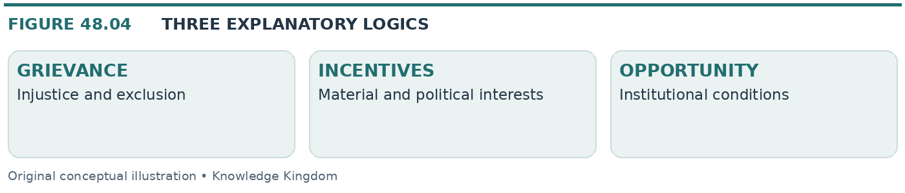

Пол Collier и Anke Hoeffler на влиятелни изследвания тествани икономически и недоволство, свързани с обясненията на гражданската война. Техните открития помогнаха да се насочи вниманието към материалните условия, които правят организирания бунт възможен, въпреки че интерпретацията на тези констатации предизвика широк дебат. \[<a href="/048-civil-wars-and-fragile-states/sources/#source-10" class="cite">10</a>\]\[<a href="/048-civil-wars-and-fragile-states/sources/#source-11" class="cite">11</a>\] Организацията се нуждае от ресурси, за да се поддържа и икономическите последици от конфликта могат да създадат различни интереси сред нейните лидери, поддръжници и по-широкото население.

Войната може да започне след политическо изключване и по-късно ще бъде свързана с икономически привилегии. От друга страна, една организация може да претендира за икономически оплаквания, въпреки че нейното ръководство преследва политическа власт. Изследователите трябва да разграничават публичните основания, индивидуалните мотиви и по-широките условия, които позволяват на конфликта да продължава. Доказателствата, необходими за оценка на всеки е различен. Търговската статистика не определя личното намерение на лидера.

По-старата фраза "смелост срещу недоволство" е запомняща се, но може да заблуди читателите да мислят, че само един мотив може да действа в даден момент. Хората наистина могат да повярват, че общността им е била онеправдана, докато ръководството също се възползва съществено от конфликта. В отделно село жителите могат да отхвърлят както правителствените, така и бунтовническите органи, докато си сътрудничат с която и да е институция, която в момента контролира основните услуги. Обяснението трябва да позволи тези различия, вместо да третира цяла общност като единен актьор.

<figure class="figure" id="figure-48-4">

<figcaption>Фигура 48.4. Не е необходимо трите подхода да бъдат взаимно изключващи се. \[10–12\]. <a class="figure-anchor" href="#figure-48-4" aria-label="Link to this figure">#</a></figcaption>
</figure>
