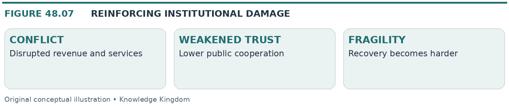

Да предположим, че системата за обществено здраве губи персонал и данъчни приходи поради конфликти. Семействата стават по - малко способни да получат медицинска помощ. Доверието им в институциите, отговорни за обществените услуги, може да намалее, особено ако разпространението изглежда дискриминационно. Тъй като доверието намалява, сътрудничеството с публичните институции може да стане по-трудно, което допълнително намалява тяхната ефективност.

Това е подсилващ кръг за обратна връзка, но не е неизбежен. Една добре поддържана местна клиника, справедлива процедура за подаване на жалби или независим публичен бюджет могат да възстановят доверието в конкретна институция дори когато националната политика остава трудна. Възстановяването често започва неравномерно. Подобряването на една община може да не се вижда веднага в националната статистика, но това може да има голямо значение за хората, които живеят там.

В Световния доклад за развитие от 2011 г. се твърди, че законните институции, предоставящи сигурност, правосъдие и икономически възможности, са важни за прекъсването на циклите на насилие. \[<a href="/048-civil-wars-and-fragile-states/sources/#source-7" class="cite">7</a>\] Въпросът не е, че една единствена реформа може да гарантира мир. Множество системи зависят един от друг: работните места изискват функционираща инфраструктура и правна сигурност; публичните институции изискват приходи и сътрудничество; сътрудничеството изисква надеждно и справедливо третиране. Перспективата на системите помага да се обясни защо краткосрочната спешна помощ и дългосрочната институционална реформа следва да бъдат оценени заедно.

Тези цикли илюстрират и проблем при оценката на превенцията. Една успешна програма може да няма драматично събитие, което да покаже като свое постижение. Да предположим, че един район създаде доверен механизъм за борба със земята и не последва организирано насилие. Трудно е да се разбере дали програмата е предотвратила конфликт или районът би останал мирен. Сравняването на резултатите с подобни области, разглеждането на доказателствата за оплакванията е разрешено и проследяването на промените в доверието в институциите може да засили изводите. Липсата само на насилие не може да докаже, че е проработила конкретна превантивна намеса.

<figure class="figure" id="figure-48-7">

<figcaption>Фигура 48.7. Концептуална обратна връзка, не неизбежна последователност. <a class="figure-anchor" href="#figure-48-7" aria-label="Link to this figure">#</a></figcaption>
</figure>
