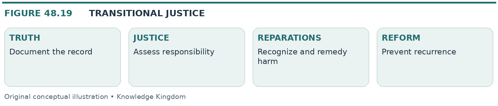

Преходната справедливост се отнася до процеси, чрез които обществата се сблъскват със сериозни нарушения на правата на човека и свързаните с тях наследници по време на или след политически преход. Нейните механизми могат да включват наказателно производство, търсене на истината, репарации, институционална реформа и мерки за предотвратяване на повторната поява. \[<a href="/048-civil-wars-and-fragile-states/sources/#source-47" class="cite">47</a>\] Тези инструменти имат различни цели и доказателствени стандарти. Акаунтът на комисията по истината не е криминално осъждане; съдебно решение относно един обвиняем не установява вина за всеки член на общността му.

Желанието за мир може да създаде натиск за избягване на политически трудни въпроси за миналото. Но оцелелите може разумно да смятат, че едно споразумение, което пренебрегва преживяванията им за непълни или несправедливи. Обратно, прокуратурата трябва да зачита справедлив процес, дори когато твърденията се отнасят до тежки престъпления. Легитимността на отчетността зависи отчасти от нейната независимост от политиката на колективно отмъщение. Международното наказателно право, обсъдено в глава 46, отличава правните категории и индивидуалната отговорност именно защото твърденията трябва да бъдат оценени срещу доказателства.

Репарациите могат да бъдат под формата на материални или символични форми в зависимост от приложимото право и институционални договорености. Само плащането не може да заличи страданието; само официално признание може да не отговори на икономическите нужди на оцелелия. Решенията трябва да включват засегнати хора, вместо да се приема, че правителството може да определи значението на възстановяването за тях. Етичната цел не е да се налага една задължителна национална памет. Трябва да се установи достоверно досие, да се признаят правата и да се предотврати отричането на достойнството, което направи злоупотребите възможни.

<figure class="figure" id="figure-48-19">

<figcaption>Фигура 48.19. Тези механизми имат различни цели и могат да се подсилват взаимно. <a class="figure-anchor" href="#figure-48-19" aria-label="Link to this figure">#</a></figcaption>
</figure>
