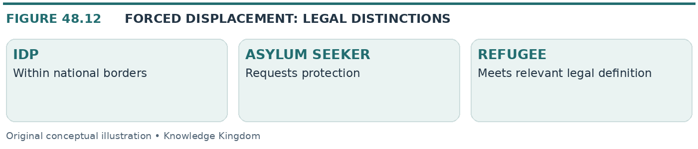

Разместването не е просто движение на карта. Семейство, напускащо дома си, може да загуби достъп до работа, образование, медицински досиета, документи за собственост и социалните взаимоотношения, от които зависи ежедневният живот. Възрастен човек може да бъде отделен от детегледачка; детето може да прекара месеци без последователно обучение. Тези прекъсвания могат да продължат дълго след падането на прякото насилие.

Вътрешно разселени лица (ИДП) са били принудени да напуснат дома си, без да преминат международно призната държавна граница. Бежанец е преминал границата и отговаря на съответното правно определение; Конвенцията за бежанците от 1951 г. и регионалните инструменти осигуряват важни рамки. Търсещ убежище е поискал защита и очаква да бъде определено къде се прилага тази процедура. Не всеки човек, който пресича граница е законно бежанец и не всеки насилствено изселен човек преминава през такава. \[<a href="/048-civil-wars-and-fragile-states/sources/#source-37" class="cite">37</a>\]\[<a href="/048-civil-wars-and-fragile-states/sources/#source-38" class="cite">38</a>\]

Според доклада на ВКБООН от 2026 г. средногодишните тенденции глобалното принудително преместване остава между 117 и 119 милиона в края на септември 2026 г. Това е прогнозиран брой хора в даден момент, а не броят на новоизселените през тази година и не се отнася изключително за граждански войни. \[<a href="/048-civil-wars-and-fragile-states/sources/#source-39" class="cite">39</a>\] Акциите се променят чрез ново изместване, връщане, местна интеграция, смърт и други промени в правния или статистически статус. Следователно отговорното докладване посочва датата, дефиницията на популацията и несигурността. По-важното е, че той признава, че сумарната цифра не може да опише обстоятелствата на всяко лице.

Трайните решения за преместване също изискват внимателна интерпретация. За бежанците възможните решения включват доброволно завръщане, местна интеграция или презаселване, всяка от които има правно и институционално измерение. Вътрешно разселените лица могат да се завърнат, интегрират на местно равнище или да се установят на друго място в тяхната страна. Връщането в определено село не е задължително трайно решение, ако домакинството все още няма безопасност, документация или достъп до основни услуги поради преместването си. \[<a href="/048-civil-wars-and-fragile-states/sources/#source-58" class="cite">58</a>\] Затова правителство, което обявява голям брой завършеци само по тази статистика, не е установило, че съществуват условия за устойчиво възстановяване. Индивидуалният избор и защита трябва да останат в центъра на оценката.

<figure class="figure" id="figure-48-12">

<figcaption>Фигура 48.12. Категориите се различават; юридическото положение и обстоятелствата могат да се променят. <a class="figure-anchor" href="#figure-48-12" aria-label="Link to this figure">#</a></figcaption>
</figure>
