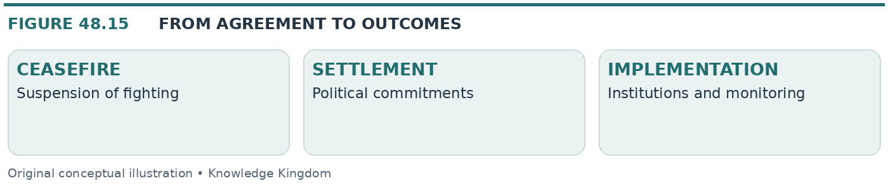

Прекратяването на огъня се отнася до спирането или намаляването на борбата при определени условия. Политическото уреждане засяга споровете, институциите или взаимоотношенията, които правят възможен продължаващия конфликт. Изследователите могат да сравнят действителната формулировка на споразуменията чрез бази данни като PA-X, вместо да разчитат единствено на публични съобщения. \[<a href="/048-civil-wars-and-fragile-states/sources/#source-54" class="cite">54</a>\] Двете могат да бъдат тясно свързани, но едната не произвежда автоматично другата. Хуманитарна пауза може да позволи спешна помощ без уреждане на конституционен спор, докато цялостно мирно споразумение може да съдържа разпоредби за прекратяване на огъня заедно с правни и политически реформи.

Прекратяването на огъня може да създаде пространство за дипломация, но тълкуването и прилагането му могат да се оспорват. Страните могат да не се споразумеят за това какво представлява нарушение, дали даден инцидент е бил разрешен от лидерите или дали споразумението се отнася до определена организация. Независимите наблюдения и надеждното докладване могат да намалят несигурността, въпреки че не могат да премахнат несъгласието. Институциите за мониторинг следва да имат ясни мандати, достъп и процедури за съобщаване на констатации.

Ключовото разграничение е между документ и институция. Документът записва ангажиментите; институциите правят възможно прилагането, преразглеждането и прилагането им. Споразумение, което обещава равен достъп до съдилища, е смислено само ако съдилищата могат да работят, жителите могат да носят дела безопасно и съдебните решения имат практически ефект. От друга страна, несъвършеното временно споразумение може да бъде полезно, ако създава условия за последващи реформи. Възможно е да се подкрепят мерки, които намаляват незабавно страданието, без да се преструват, че решават всеки основен политически въпрос.

Превенцията и посредничеството могат да възникнат на няколко нива. В един град несъгласието относно достъпа до общ пазар може да се реши чрез местни представители. На национално равнище конституционната реформа може да изисква преговори между политическите партии. Международните медиатори могат да подпомагат по-широко уреждане. Това не са конкурентни обяснения на мира, а допълващи институционални процеси. Споразумение, договорено между националните лидери, може да остане абстрактно за хора, които не могат да получат документи за собственост или да посещават училището безопасно. Обратно, местното сътрудничество не може само да реши спор относно правните правомощия на националните институции. Ръководството на ООН за посредничество подчертава приобщаващите процеси, националната собственост и правните рамки; неговата работа по местното посредничество свързва тези процеси с по-широки политически усилия. \[<a href="/048-civil-wars-and-fragile-states/sources/#source-55" class="cite">55</a>\]\[<a href="/048-civil-wars-and-fragile-states/sources/#source-56" class="cite">56</a>\]\[<a href="/048-civil-wars-and-fragile-states/sources/#source-57" class="cite">57</a>\]

<figure class="figure" id="figure-48-15">

<figcaption>Фигура 48.15. Документът записва ангажиментите; изпълнението изисква институции. <a class="figure-anchor" href="#figure-48-15" aria-label="Link to this figure">#</a></figcaption>
</figure>
