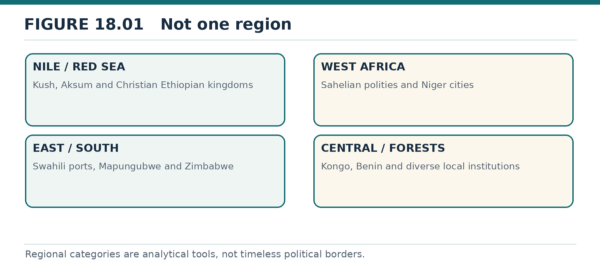

Imagine a merchant approaching the city of Timbuktu in the fourteenth century. After days of travel, the caravan has crossed stretches of the Sahara by moving between wells and settlements. Its loads may contain salt from desert mines, cloth, metal goods and other items with buyers farther south. At the edge of the Niger River system, commercial possibilities multiply: boats carry grain and other produce, merchants argue over value and credit, and scholars discuss books that have moved through networks stretching far beyond any one kingdom. This scene is a historical reconstruction, not a report of a particular merchant's journey. It captures a reality that deserves to be placed at the center of world history: the Sahara was dangerous, but it was not an impenetrable wall.

Africa is a continent of immense regional variation. The Mediterranean coast, Atlantic forests, Sahelian grasslands, highlands of Ethiopia, central African rainforests, savannas of the south and Indian Ocean islands create sharply different possibilities for agriculture, travel and settlement. The continent is also larger than many familiar world maps suggest: the Mercator projection exaggerates high-latitude regions and can shrink Africa's apparent scale in comparison with Europe and northern Asia. Human communities responded to these environments with different crops, animals, technologies, languages, institutions and trading systems.

There is no coherent single 'African empire' that can stand for the whole past. Ancient Kush was not medieval Mali; the ports of Kilwa were not the inland city of Great Zimbabwe; the kingdom of Benin was not the country now called Benin; and a person living in sixteenth-century Kongo did not experience the same political world as someone in Aksum a thousand years earlier. This chapter follows <strong>interconnected histories</strong>, not a uniform civilization. Its broad geographical span also means that some regions receive only an introduction. Later chapters on Islam, the Atlantic, colonization and modern states will return to these histories with new questions.

<figure class="figure" id="figure-18-1">

<figcaption>Figure 18.1. Regional categories are analytical tools, not timeless political borders. <a class="figure-anchor" href="#figure-18-1" aria-label="Link to this figure">#</a></figcaption>
</figure>
