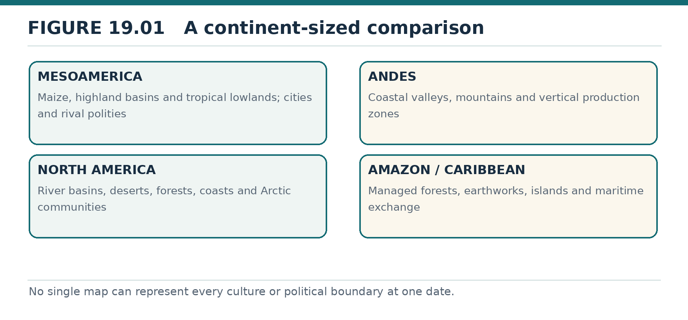

Imagine approaching Tenochtitlan in the early sixteenth century. A raised causeway stretches ahead across Lake Texcoco. Canoes move through canals carrying food and merchandise. Beyond them rise temples, palaces and busy markets; alongside the built city are intensively cultivated plots known as <em>chinampas</em>, carefully managed to supply food to a large urban population. People come and go speaking different languages and bearing obligations to different political authorities. The scene is a historically informed reconstruction rather than an eyewitness transcript. It asks a simple question: how did such an immense city develop in a world whose distant history many outsiders knew so little about?

Tenochtitlan was one striking achievement among many. Centuries earlier, the Maya had recorded royal histories in a complex writing system and traced long intervals in carefully calculated calendars. In the Andes, societies built ceremonial centers, irrigated dry valleys and constructed roads through daunting mountains. On the Mississippi floodplain, builders raised enormous earthen monuments; in the North American Southwest, communities organized sophisticated settlements and regional exchange. In Amazonia, new archaeological techniques reveal carefully managed landscapes that older assumptions had missed. None of these developments requires a story in which the Americas were isolated, empty or waiting to be discovered.

The title 'before European conquest' is a practical boundary, not a claim that Indigenous history ended at first contact. The sequence of encounters varied: Atlantic voyages began to transform Caribbean lives from 1492, the Mexica-led empire was defeated in 1521, the Inka state faced invasion from 1532, and many other Indigenous societies continued to negotiate, resist and transform over subsequent centuries. Nor was 1492 the first moment people from outside the Americas ever reached its shores; Norse voyages reached the North Atlantic centuries earlier without producing the hemisphere-wide consequences of later colonization. The people discussed here have living descendants and, in many regions, continuous communities and languages today.

<figure class="figure" id="figure-19-1">

<figcaption>Figure 19.1. No single map can represent every culture or political boundary at one date. <a class="figure-anchor" href="#figure-19-1" aria-label="Link to this figure">#</a></figcaption>
</figure>
