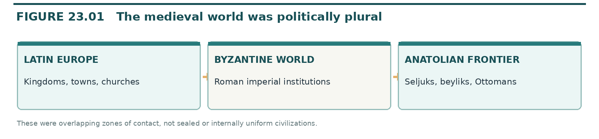

Imagine three messengers arriving at Constantinople in the spring of 1453. One has travelled from a western Christian court, carrying letters about negotiations and help that may come too late. Another has crossed the Balkans, where rulers and families have spent generations navigating Ottoman taxation, alliances and warfare. The third approaches from the camp of Sultan Mehmed II, where artillery crews, soldiers, engineers, sailors and administrators support a formidable siege. This is a deliberately constructed teaching scene, not a documented gathering of three specific men. It helps us see how one city could stand at the intersection of several histories.

From within its walls, the ruler Constantine XI still claimed the dignity of a Roman emperor. His state was tiny compared with its medieval predecessors, but its church, law, language and political memory reached across centuries. Across the frontier stood a dynasty that had emerged only about a century and a half earlier and was already commanding populations of different languages and faiths. Farther west lay kingdoms, principalities, city-republics and churches whose rivalries complicated any collective response. To understand 1453 we must resist the simple story of an old civilization exhausted by a young and irresistible one. The outcome had been shaped by taxation, dynastic wars, commercial privilege, religious division, geography, military organization and decisions made over several generations.

The question guiding this chapter is therefore broader than who conquered Constantinople. How did medieval governments acquire resources and legitimacy? Why did Europe's regions develop different political arrangements? How did the Byzantine, Bulgarian, Serbian, Latin and Ottoman worlds interact? And how could the loss of an imperial capital coincide with the survival and reinvention of many of its traditions?

<figure class="figure" id="figure-23-1">

<figcaption>Figure 23.1. These were overlapping zones of contact, not sealed or internally uniform civilizations. <a class="figure-anchor" href="#figure-23-1" aria-label="Link to this figure">#</a></figcaption>
</figure>
