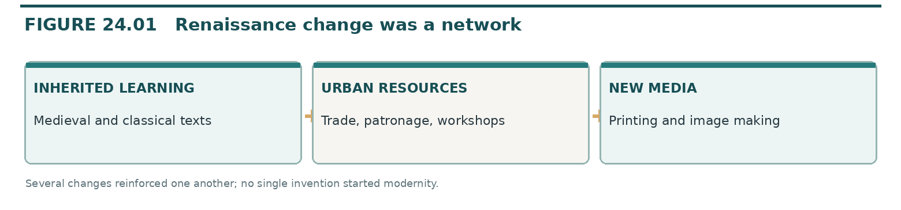

Imagine a visitor walking through Florence around 1475. At a manuscript seller's shop, a reader compares copies of a Latin classic, wondering whether generations of scribes have introduced errors. A short walk away, a painter argues with a patron about the cost of pigments and the positioning of figures in an altarpiece. In a merchant's office, correspondence records debts, ship movements and exchange rates. Somewhere beyond the Alps, printers in German towns are already preparing multiple nearly identical copies of books by arranging metal letters into reusable pages. This is a composite teaching scene, not the record of an individual visitor. Its point is that cultural change occurred in shops, countinghouses, schools and courts as well as in the minds of celebrated geniuses.

The term Renaissance, meaning rebirth, refers especially to a European cultural movement associated with the recovery, study and imitation of classical Greek and Roman learning. Its strongest early centers were in Italian towns from the fourteenth century, and related approaches developed elsewhere over the following two centuries. Yet rebirth is itself a historical claim. The people who praised their own renewal sometimes exaggerated the supposed ignorance of their medieval predecessors. They inherited universities, commercial institutions, Christian scholarship, Islamic and Byzantine transmissions of ancient knowledge, and artistic traditions that had never ceased developing.

This chapter asks why Italian cities became especially fertile centers of experimentation, what humanists actually studied, how art and scholarship were financed, why techniques of representing nature mattered, and how printing changed the scale and politics of communication. It also asks whose experiences these celebrated changes excluded. The Renaissance was neither a miracle performed by a few individuals nor the instant invention of the modern world. It was a set of connected transformations with earlier roots and unequal consequences. \[<a href="/024-renaissance-humanism-and-printing/sources/#source-1" class="cite">1</a>\]\[<a href="/024-renaissance-humanism-and-printing/sources/#source-2" class="cite">2</a>\]

<figure class="figure" id="figure-24-1">

<figcaption>Figure 24.1. Several changes reinforced one another; no single invention started modernity. <a class="figure-anchor" href="#figure-24-1" aria-label="Link to this figure">#</a></figcaption>
</figure>
