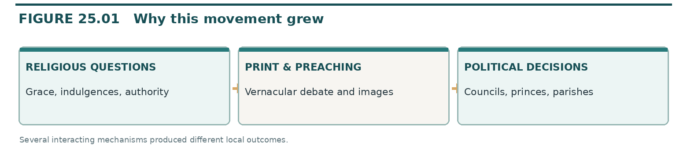

Imagine an autumn morning in a German town in the 1520s. A printer opens his shutters to display a freshly inked pamphlet. A merchant buys a copy, perhaps because a woodcut shows a familiar preacher criticizing wealthy churchmen. At the market, two neighbors argue about whether Christians need a priest to interpret scripture. A city councillor wonders whether changing public worship would bring peace, a tax dispute, or the anger of a neighboring prince. A widow worries that the prayers said for her deceased husband may be abandoned. This is a composite teaching scene, not a diary entry. It draws together problems that different communities confronted as religious controversies spread through towns, villages and courts.

From a distance, the Protestant Reformation can look like a simple sequence: Martin Luther denounced abuses in 1517, the printing press spread his message, and Europe divided into Protestant and Catholic countries. Every link in that outline needs qualification. Reformers disagreed with one another about theology and worship; Catholics developed extensive renewal movements of their own; princes often hesitated, negotiated, or changed alliances; ordinary believers did not always follow the wishes of rulers. Religious conflict became especially destructive when linked to dynastic rivalry, property, territorial jurisdiction and the resources of early modern states.

The guiding questions in this chapter are not merely who was right about doctrine or who won particular battles. They are how different kinds of authority collided, why some appeals to conscience became coercive institutions, how media and political geography changed outcomes, and how European conflicts connected to a larger world of Orthodox Christians, Muslims, Jews, and expanding overseas empires. A religious argument could be sincerely about salvation and simultaneously alter rents, schools, marriage law and international diplomacy. That complexity is the history we need to understand. \[<a href="/025-reformation-and-religious-conflict/sources/#source-1" class="cite">1</a>\]\[<a href="/025-reformation-and-religious-conflict/sources/#source-2" class="cite">2</a>\]

<figure class="figure" id="figure-25-1">

<figcaption>Figure 25.1. Several interacting mechanisms produced different local outcomes. <a class="figure-anchor" href="#figure-25-1" aria-label="Link to this figure">#</a></figcaption>
</figure>
