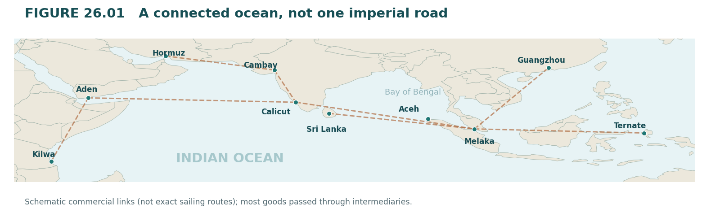

Imagine a merchant in the port of Calicut on India's Malabar coast around 1500. A vessel from the Arabian Peninsula has unloaded horses and goods that cannot easily be produced locally. Nearby, textiles from Gujarat are being repacked for Southeast Asian customers. Pepper passes through brokers who know foreign languages, local rulers' customs officers and the cost of storage. A sailor asks when the favorable monsoon will return. An accountant calculates whether credit extended months earlier can be repaid before the next voyage. This scene is a deliberately composite reconstruction, not a recovered diary of one particular merchant. Its parts help us see why commerce across a vast ocean could function without a single empire governing all its shores.

It would be misleading to begin this history with a Portuguese ship. When Vasco da Gama reached Calicut in 1498, merchants had already exchanged goods, practices, people and beliefs across the Indian Ocean for many centuries. Traders connected the Swahili coast with Arabia, the Persian Gulf with India, and the Bay of Bengal with Southeast Asia and China. Political authorities competed for customs revenues, protection payments and diplomatic influence, but much exchange rested on agreements negotiated locally by people who crossed boundaries of language, faith and jurisdiction.

The Indian Ocean system was not a harmonious market without coercion. Captives were transported across seas, rulers seized ships, monopolies and taxes favored some traders over others, and warfare could ruin ports. Nor was it one uniform network: different coastal circuits overlapped, and merchants often handed goods on to intermediaries rather than sailing the full distance. The chapter asks how such a system worked, who gained from it, who suffered, and what changed between approximately 1400 and 1650. It also asks a broader question that will matter in the next chapter: does arriving with powerful ships mean that newcomers control the trade they hope to enter? \[<a href="/026-indian-ocean-commerce-and-asian-powers/sources/#source-1" class="cite">1</a>\]\[<a href="/026-indian-ocean-commerce-and-asian-powers/sources/#source-2" class="cite">2</a>\]\[<a href="/026-indian-ocean-commerce-and-asian-powers/sources/#source-3" class="cite">3</a>\]

<figure class="figure" id="figure-26-1">

<figcaption>Figure 26.1. No single authority governed the entire network. <a class="figure-anchor" href="#figure-26-1" aria-label="Link to this figure">#</a></figcaption>
</figure>
