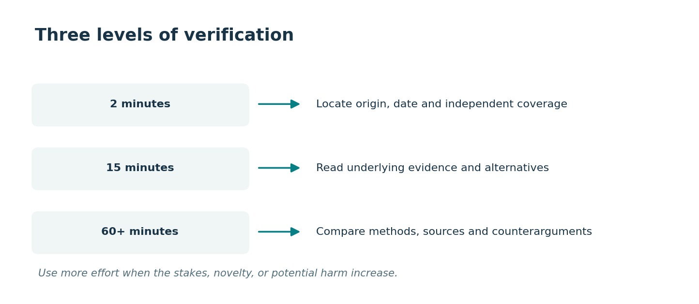

Not every claim merits an afternoon in the library. You need a method that fits the stakes.

## Two minutes: the everyday check

State the claim in one sentence. Identify whether it is descriptive, causal, predictive, or evaluative. Look for the original source and date. Search a second, genuinely independent source or authoritative summary. If you cannot establish a basic fact quickly, do not forward it as established. A short pause prevents a surprising amount of avoidable misinformation.

## Fifteen minutes: the consequential check

Find the underlying report, data release, full video, or primary historical evidence. Compare what it actually says with the headline. Note definitions, the relevant comparison group, the size of the effect, and unresolved limitations. Identify at least one plausible alternative interpretation. If the topic has an expert consensus, learn what it is and which parts remain open. Finish with a short confidence statement.

## One hour or longer: the serious inquiry

For a question you will teach, publish, make a costly decision on, or use to judge another person, read competing high-quality explanations. Separate independent sources from copies. Check chronology and methods. Write an evidence table: claim, source, what the source directly establishes, limitations, and what would change your conclusion. Do not let exhaustive research become a way of avoiding a decision forever; know what accuracy is proportionate to the consequences.

<figure class="figure" id="figure-1-5">

<figcaption>Figure 1.5. Match the intensity of checking to the decision. <a class="figure-anchor" href="#figure-1-5" aria-label="Link to this figure">#</a></figcaption>
</figure>

## Your personal evidence notebook

Create a page with six columns: <strong>Claim / Why it matters / Best evidence / Alternative explanation / Confidence / Next check</strong>. Fill it with a real-world question once a week. For example: “Does learning a foreign language improve memory?” or “Why did this historical empire expand?” You will soon notice that some questions have clear factual answers, others have multiple interacting causes, and still others depend on contested definitions. The notebook is useful precisely because it forces those distinctions onto the page.
