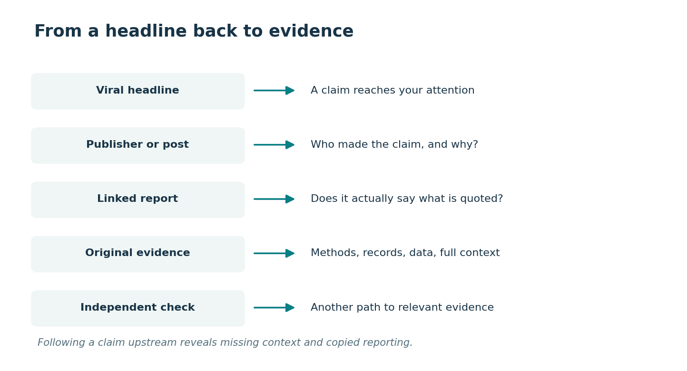

Imagine reading: “New research proves that people who drink tea every day live ten years longer.” The website looks elegant and cites “a major university.” Another site repeats the assertion. An influencer references both. The claim now seems well supported because you can find it in several places. But perhaps every version derives from a single press release about a study that found a small association between tea drinking and mortality in one particular group. No researcher claimed a ten-year increase in lifespan.

To investigate, move backward through the information chain. Find the news article. Open the press release if one exists. Locate the research paper or institution's original statement. Ask what the study measured, whom it included, and what its authors actually concluded. Check whether an independent expert has evaluated it. The word <em>proves</em> is often a warning sign when the subject is complex and the study is observational.

The Stanford research program on civic online reasoning has shown why this matters. In observational studies of online evaluation, professional fact-checkers often left an unfamiliar website to investigate its background using other sources; historians and students were more likely to stay on the original site and judge its appearance. The approach is called <strong>lateral reading</strong>. It is not a guarantee of accuracy, but it is a valuable way to avoid being persuaded by a polished page before you know who stands behind it. \[<a href="/001-how-to-know-what-is-true/sources/#source-2" class="cite">2</a>\]\[<a href="/001-how-to-know-what-is-true/sources/#source-3" class="cite">3</a>\]

A practical version is the SIFT method, developed by Mike Caulfield: <strong>Stop; Investigate the source; Find better coverage; Trace claims, quotations, and media to the original context.</strong> \[<a href="/001-how-to-know-what-is-true/sources/#source-4" class="cite">4</a>\] This is a workflow, not a rigid law. You may need to begin with a search for the source or compare several original records, and serious investigation requires more than four steps. But as an everyday discipline, it gives you an efficient place to start.

## When several sources are not really several sources

Suppose four newspapers report the same statistic. Newspaper B copied Agency A; Newspaper C summarized B; Newspaper D quoted C. You have four publications but essentially one underlying evidential path. Their agreement may show that the story spread widely, not that it was independently checked. Trace the source chain. Compare a direct statistical release with a separate investigation using other data. Ask whether alternative explanations were examined.

It is also possible to demand too much from ordinary knowledge. You do not have to read the entire scholarly literature before learning the age of the Roman Empire. An accessible scholarly survey can be appropriate. The degree of investigation should rise with the stakes, novelty, controversy, and consequences of acting on the claim.

<figure class="figure" id="figure-1-1">

<figcaption>Figure 1.1. Tracing one claim through the reporting chain. <a class="figure-anchor" href="#figure-1-1" aria-label="Link to this figure">#</a></figcaption>
</figure>
