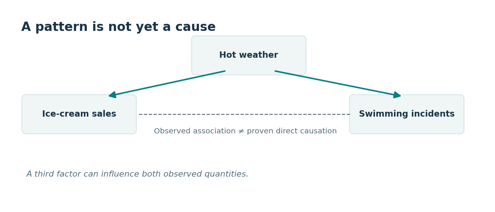

A new mayor takes office, and employment rises the following year. The mayor announces that the economic program succeeded. The opposition says the worldwide recovery created the jobs. A local business group credits new transport links. Every explanation might contain part of the truth; the observed increase alone does not identify the cause.

The conceptual difficulty is the <strong>counterfactual</strong>. To say the mayor's policy caused the increase is to ask, in effect, what employment would have been if the policy had not occurred, with relevant other conditions held comparable. We cannot ordinarily observe both the policy and no-policy worlds for the very same city at the same time. We therefore compare: with similar cities, earlier trends, policy implementation differences, or, where feasible, randomly assigned interventions.

Three pitfalls recur. <strong>Confounding:</strong> a third factor influences both the supposed cause and the outcome. Hot weather may increase both ice-cream sales and swimming-related incidents. <strong>Reverse causation:</strong> the direction runs the other way. Better health may allow people to exercise more, even if exercise also improves health. <strong>Selection bias:</strong> people receiving a treatment or entering a program may differ systematically from those who do not. An optional tutoring program may attract the most motivated students; high marks among attendees do not isolate the program's effect.

Randomized controlled trials can help balance measured and unmeasured differences between groups, provided assignment is implemented properly and other design problems are handled. Yet many important questions cannot be randomized. We cannot assign nations to centuries of colonial rule or randomly manufacture a devastating earthquake. Researchers instead compare natural experiments, use historical evidence, test mechanisms, and report uncertainty. Observational research can sometimes support persuasive causal inference; it simply demands extra care about assumptions.

Avoid the opposite mistake of assuming that because correlation is not enough, correlations are useless. A repeated association can provide a lead, help make forecasts, or form part of a larger causal argument. A good investigator asks how the pattern fits plausible mechanisms, alternative explanations, temporal order, and evidence from other methods.

<figure class="figure" id="figure-1-2">

<figcaption>Figure 1.2. An observed association may have a shared cause. <a class="figure-anchor" href="#figure-1-2" aria-label="Link to this figure">#</a></figcaption>
</figure>

## Case study: did a railway transform a region?

Suppose a railway opens and regional trade doubles in ten years. This matters. But to understand how much the railway contributed, investigate whether the trading area also gained ports, factories, population, or favorable tariffs; whether nearby regions without railways grew similarly; whether goods travelled by road before the line opened; and whether rail access itself was built <em>because</em> the region was already becoming richer. A strong answer may conclude that rail access probably mattered while admitting that its exact contribution is hard to quantify.

The lesson applies from economic policy to medical treatment and military history: <strong>a plausible story about a cause is a hypothesis, not its own proof.</strong>
