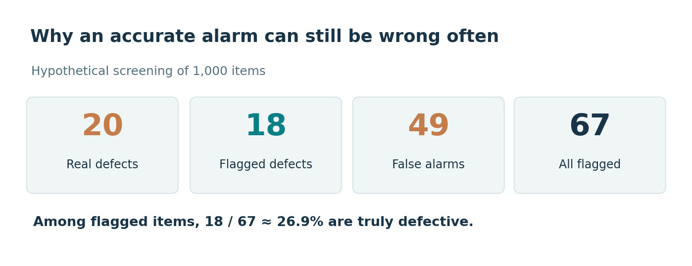

Imagine you are told that an alarm detects 90 percent of defective products. “The alarm went off,” says a colleague. “So the product is almost certainly defective.” That conclusion does not follow. We also need to know how rare defects are and how often the alarm mistakenly flags good products. Chapter 3 develops this calculation in depth; here the important idea is that <strong>new evidence updates what you believed before</strong>, rather than floating independently of the base rate.

This is the intuition behind Bayesian reasoning. An initial belief, sometimes called a <strong>prior</strong>, is revised in light of how likely new evidence would be under competing explanations. The result is an updated probability, or <strong>posterior</strong>. You can understand this without memorizing a formula.

Consider a hypothetical factory making 1,000 items. Twenty are defective, and 980 are fine. A screening device correctly flags 18 defective items (90 percent sensitivity) but also mistakenly flags 49 good items (5 percent false-positive rate). In total it flags 67 items, only 18 of which are defective. That means about 27 percent of flagged items are actually defective, not 90 percent. All quantities here are invented to teach the calculation. Change the defect rate or false-alarm rate, and the answer changes.

This may feel surprising because the dramatic new information—the alarm—captures our attention, while the quiet background fact—that almost all items are good—does not. The same error appears in interpretation of fraud alerts, security screenings, rare disease tests, and sensational news about improbable events. The evidence can be informative and still leave substantial uncertainty.

<figure class="figure" id="figure-1-4">

<figcaption>Figure 1.4. Natural frequencies show why the base rate matters. <a class="figure-anchor" href="#figure-1-4" aria-label="Link to this figure">#</a></figcaption>
</figure>

Outside numerical cases, the principle remains powerful. You hear that a city is losing residents. Your initial view is based on a decade of population statistics. A single friend reports that several families recently moved away. Their report is new evidence, but it should not outweigh a well-measured population series without further reason. Conversely, a new census showing a sustained decline should produce a serious update. Beliefs that never change are poorly calibrated to evidence; beliefs that swing dramatically with each anecdote are poorly calibrated in another way.

A useful habit is to state confidence before checking and then ask what would cause a meaningful revision. You need not assign exact probabilities to everything. For a claim that can be tested, “I think this is plausible but uncertain” is more honest than inventing “73 percent confidence” merely to sound scientific.
