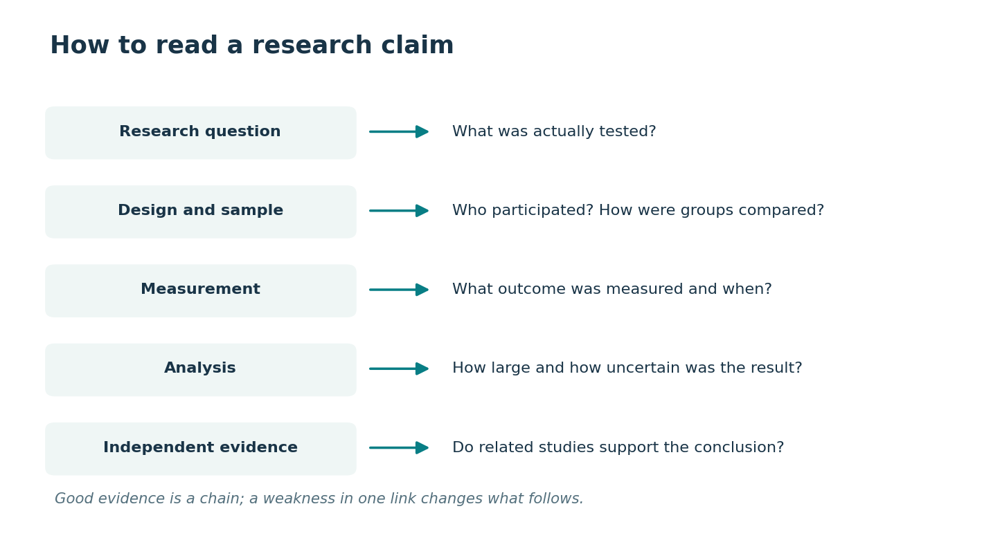

Suppose the headline says: “New study finds that a supplement improves memory by 30 percent.” What do you need to know? First, what was measured? Perhaps participants recalled 13 words instead of 10 on a 30-word test; this is a 30 percent increase relative to 10 words, not a 30-percentage-point improvement in the ability to remember everything. Second, how many participants were studied and how were they recruited? Third, was there a credible comparison group? Fourth, were outcomes chosen in advance or selected after examining many possibilities?

A study of twenty volunteers cannot automatically tell us what will happen in millions of people. Even a larger study may fail to generalize if participants are drawn from a narrow age range or setting. Random assignment helps distinguish a treatment from preexisting differences, but attrition, poor measurement, selective reporting, and chance can still distort findings. <strong>Effect size</strong> asks how large the difference is; <strong>uncertainty</strong> asks how precisely that difference has been estimated; and <strong>practical significance</strong> asks whether the difference matters in real life.

Statistics add another trap. A p-value is sometimes misread as “the probability the result happened by chance” or “the chance the hypothesis is wrong.” Those are not its general meanings. The American Statistical Association warns that p-values do not measure the probability that a hypothesis is true and should not be the sole foundation of a decision. \[<a href="/001-how-to-know-what-is-true/sources/#source-6" class="cite">6</a>\] You do not need to become a statistician to ask whether authors report effect sizes, uncertainty intervals, study limitations, and independent supporting work.

When you hear “experts have proved,” ask how far the original research actually goes. If the underlying study compares two groups over four weeks, it cannot directly establish a ten-year outcome. If the study uses mice, its result may be scientifically interesting without being established in humans. If the researchers only found that two behaviors appear together, the headline should not casually claim that one behavior caused the other.

The most informative headline would often be the least dramatic: “One study finds a modest association; more research needed.” That is less likely to travel rapidly through social media, but more likely to be faithful to the evidence.

<figure class="figure" id="figure-1-3">

<figcaption>Figure 1.3. Questions to ask before relying on a new research result. <a class="figure-anchor" href="#figure-1-3" aria-label="Link to this figure">#</a></figcaption>
</figure>
