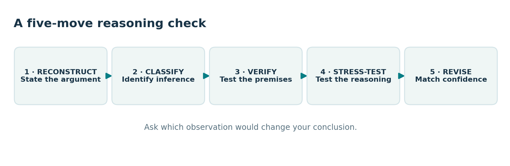

When confronted with a difficult claim, use five deliberate moves. <strong>First, reconstruct it:</strong> state the conclusion and its reasons in clear language. <strong>Second, classify it:</strong> is it a deductive inference, an inductive forecast, an explanatory hypothesis, or a recommendation that also involves values? <strong>Third, test the premises:</strong> which ones are known, which are disputed, and what evidence would help? <strong>Fourth, test the inference:</strong> do the premises actually support the conclusion at the strength stated? <strong>Fifth, formulate the strongest objection and then revise:</strong> what would a fair-minded critic ask, and how should your confidence or wording change?

The process can take one minute or several days. For an everyday remark, you might say, “That is possible, but what else could explain it?” For a serious policy proposal, you might construct a spreadsheet, interview specialists, consult legal documents and examine comparative studies. The principle scales to the stakes. Reasoning does not eliminate uncertainty; it makes your response to uncertainty more disciplined.

<figure class="figure" id="figure-2-4">

<figcaption>Figure 2.4. The five-move method is reusable across everyday and academic arguments. <a class="figure-anchor" href="#figure-2-4" aria-label="Link to this figure">#</a></figcaption>
</figure>

One extra habit makes the method more humane. Ask yourself: <strong>“If the evidence surprised me, would I let it change my conclusion?”</strong> This is not an instruction to abandon convictions on demand. Strong convictions may rest on strong reasons. It is a reminder that genuine inquiry involves some risk that you might learn something inconvenient. An argument that cannot in principle be revised by any conceivable evidence may be expressing an identity or moral commitment rather than a testable factual hypothesis.
