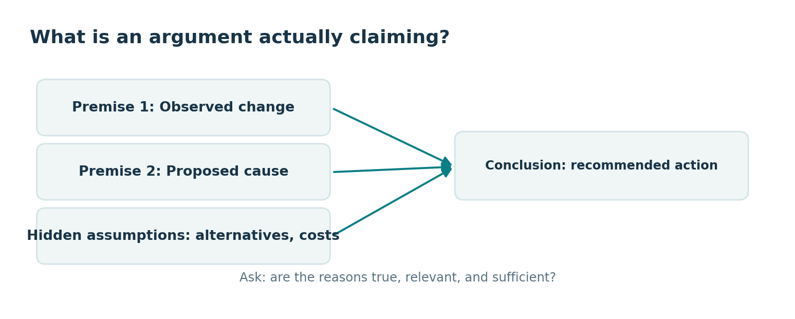

An argument, in the philosophical sense, is not a quarrel. It is a collection of statements in which some—called <strong>premises</strong>—are offered in support of another—called the <strong>conclusion</strong>. Consider this deliberately simple example: “All mammals are warm-blooded. Whales are mammals. Therefore whales are warm-blooded.” The first two sentences supply the reasons; the last supplies what those reasons are meant to establish.

The words <em>therefore</em>, <em>so</em>, <em>hence</em> and <em>as a result</em> often introduce conclusions; <em>because</em>, <em>since</em> and <em>given that</em> often introduce premises. They are clues rather than rules. “Since Monday” tells you when something happened, not why a conclusion follows. Many arguments lack any clue words at all. “She has been practicing consistently for six months. Her performance should improve.” The second sentence is a prediction backed by the first.

A statement capable of being true or false is sometimes called a <strong>proposition</strong>. “The bridge opened in 1980” is a proposition; “Please close the door” is generally a request, not a proposition. Arguments can include commands, questions, stories and emotional appeals, but the reasoning that we evaluate typically depends on propositions. This distinction matters because an angry demand does not become an explanation merely because it was delivered confidently.

To reconstruct an argument, write the conclusion first. Next write each premise separately. Then ask whether anything else must be assumed. For example: “The shop should extend its hours because it made more sales on Saturday.” We can reconstruct it as: (1) Saturday sales exceeded sales on a typical day; (2) longer hours would cause enough additional profitable sales to justify their cost; (3) therefore the shop should extend its hours. The second premise, which might be precisely the issue, was smuggled into a casual sentence without discussion.

The same approach clarifies politics. “This policy reduces crime, so we must adopt it” may conceal assumptions about its cost, constitutionality, side effects, effectiveness relative to alternatives and the weight we place on different forms of safety. The speaker might have a genuine point. But genuine points do not eliminate trade-offs. An argument map makes a claim debatable rather than merely dramatic.

<figure class="figure" id="figure-2-1">

<figcaption>Figure 2.1. Make the hidden assumptions visible before evaluating the conclusion. <a class="figure-anchor" href="#figure-2-1" aria-label="Link to this figure">#</a></figcaption>
</figure>

<strong>Try it now.</strong> A friend says, “Our town needs a new sports hall. Young people are leaving, and a sports hall will make them stay.” What is the conclusion? Which statement is offered as evidence? Which crucial causal assumption is still untested? A useful answer would distinguish the value of a sports hall from the uncertain claim that it will reverse migration.
