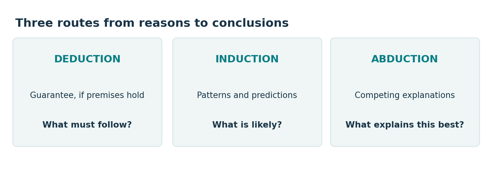

Not every argument aims to provide a deductive guarantee. Most practical thinking deals with uncertainty. Imagine that you wake to find the village streets wet. You consider three explanations: rain fell overnight, municipal workers washed the streets, or a pipe burst. The evidence is incomplete. You need to reason toward the explanation that best fits what you can observe.

<strong>Deduction</strong> asks what follows necessarily from stated premises. <strong>Induction</strong> uses observed cases to support a broader generalization or prediction, without guaranteeing it. <strong>Abduction</strong> asks which explanation best accounts for the evidence. These are not three competing loyalties; we use all three in ordinary thought. Engineers may deduce consequences from a tested model, infer reliability from repeated observations, and diagnose a malfunction by comparing rival explanations.

Suppose a shop observes that its last ten Friday evenings were busy and predicts that next Friday will also be busy. That is inductive. The evidence matters, but ten evenings may represent a holiday season or an unusual period. A stronger prediction asks how representative the sample is, whether conditions have changed and how large the uncertainty remains. Induction improves through better data and sensible comparisons; it is not magically transformed into deduction by collecting many observations.

Now suppose the Friday sales rise suddenly. You consider three hypotheses: the shop introduced a popular product; a nearby competitor closed; or an advertisement brought in new customers. This is abductive reasoning. Each proposed explanation must be tested against additional details. Did the rise begin before the advertisement? Did traffic increase mainly among shoppers who bought the new product? Did nearby residents report switching from the competitor? An explanation is stronger when it accounts for multiple observations, has a plausible mechanism, and does not rely on a pile of unsupported extra assumptions.

The phrase “best explanation” requires care. The explanation that feels most compelling is not necessarily best. Some causes are common but emotionally uninteresting; some dramatic stories are memorable but improbable. Explanations can be compared by fit with the evidence, consistency with established background knowledge, testable implications and the number of unexplained facts they leave behind. Even the best currently available explanation can be revised when new evidence appears.

<figure class="figure" id="figure-2-3">

<figcaption>Figure 2.3. Deduction, induction, and abduction answer different kinds of questions. <a class="figure-anchor" href="#figure-2-3" aria-label="Link to this figure">#</a></figcaption>
</figure>
