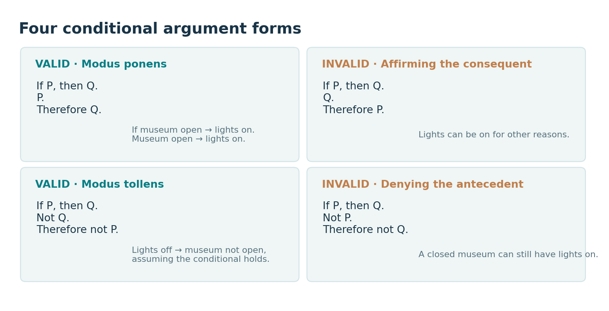

In <strong>deductive reasoning</strong>, an argument is <em>valid</em> when there is no possible situation in which all of its premises are true but its conclusion is false. This definition is about structure. It does not tell us whether the premises actually describe the world. Consider: “All reptiles are invisible. Snakes are reptiles. Therefore snakes are invisible.” The inference is valid; the initial premise is false. Because a false premise does not establish a conclusion about real snakes, this is not a <strong>sound</strong> argument.

An argument is <strong>sound</strong> if it is deductively valid and all its premises are true. Soundness is a demanding standard; we often cannot establish every premise with certainty, especially in disputed political or historical questions. Yet the distinction is essential. One question is whether the conclusion logically follows <em>if we grant the premises</em>. Another question is whether we should grant those premises. Good discussion keeps these questions separate.

Consider two hypothetical conversations. Person A says, “If the museum is open, the lights are on. The museum is open. Therefore the lights are on.” Assuming the first premise is true, the form is valid. Person B says, “If the museum is open, the lights are on. The lights are on. Therefore the museum is open.” The lights could be on because cleaners are working while the museum is closed. Person B has made a common structural error: <strong>affirming the consequent</strong>. Both arguments sound similar. Only one gives a conclusion guaranteed by the stated premises.

A third common form is <strong>denying the antecedent</strong>: “If the museum is open, the lights are on. The museum is closed. Therefore the lights are off.” The lights could still be on for another reason. The conclusion does not follow. Compare this with <strong>modus tollens</strong>, a valid form: “If the museum is open, the lights are on. The lights are not on. Therefore the museum is not open.” If the conditional truly holds without exception, this inference is valid. In real life, you may then challenge the conditional—perhaps the museum has an electrical failure—but that is a challenge to a premise, not to the logical form.

<figure class="figure" id="figure-2-2">

<figcaption>Figure 2.2. Two valid and two invalid forms of conditional reasoning. <a class="figure-anchor" href="#figure-2-2" aria-label="Link to this figure">#</a></figcaption>
</figure>

A powerful test is to seek a <strong>counterexample</strong>. To show that an inference is invalid, describe one coherent possible situation where the premises hold and the conclusion fails. For the museum example, cleaners with the lights on while the doors remain closed are enough. A single counterexample can establish that a proposed deductive inference does not guarantee its conclusion. It does not automatically show that the actual conclusion is false: the museum may indeed be open, but the lights by themselves have not demonstrated it.

This distinction is liberating. You no longer have to establish the opposite of every statement you doubt. Sometimes the accurate response is simply: “Your evidence does not yet establish that result.” A person might be correct for other reasons. The present argument has not got there.
