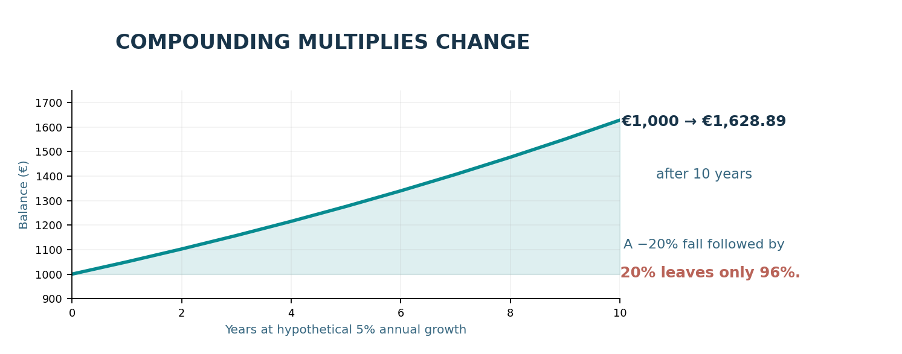

Suppose €1,000 earns a hypothetical 5 percent annual return and the return remains invested. After one year the balance is €1,050. After two it is €1,102.50. After ten, €1,000 × 1.05¹⁰ ≈ <strong>€1,628.89</strong>. The tenth year's gain is calculated on a larger base than the first year's. This is the mechanism of <strong>compound growth</strong>. It is mathematics, not a promise that any investment will earn 5 percent. In real markets, returns fluctuate, fees and taxes may apply, and losses can occur.

Compounding operates in reverse as well. If a country experiences 10 percent inflation in one year and 10 percent the next, the overall price increase is 1.1 × 1.1 − 1 = <strong>21 percent</strong>, not 20 percent. If a stock falls 20 percent then rises 20 percent, €100 becomes €80 and then €96: the investor is still down 4 percent. Recovering from a 20 percent loss requires a 25 percent gain. This asymmetry is why large losses deserve attention even when the average return looks attractive.

<figure class="figure" id="figure-3-7">

<figcaption>Figure 3.7. Repeated percentage changes apply to the new amount, not only the initial one. <a class="figure-anchor" href="#figure-3-7" aria-label="Link to this figure">#</a></figcaption>
</figure>

Another way to see the difference is to compare two salaries. One increases by €100 each year. Another increases by 3 percent each year. For a short period, the fixed amount might be better; over a long period, the percentage increase can become much larger if it continually applies to the new salary. Real wages, of course, also depend on inflation and taxes. A nominal salary can rise while purchasing power falls.

There is a famous rough mental rule sometimes called the <strong>rule of 72</strong>. Dividing 72 by a percentage growth rate provides an approximate number of periods needed to double under steady compounding: at 6 percent per year, roughly 12 years. The exact time follows the logarithmic relationship; for 6 percent growth, it is approximately 11.9 years. Use the rule as an estimate, not as a substitute for checking the assumptions. Compounding can help explain population change, debt growth, and technological adoption too, but growth rarely continues unconstrained forever.
