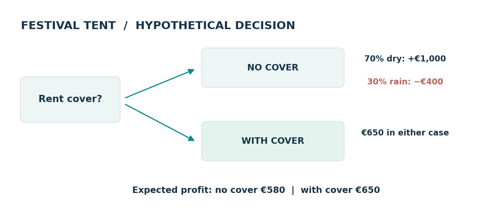

A simple <strong>decision tree</strong> separates what you can choose from what you cannot control. Start with an action. List the outcomes that might follow, assign plausible probabilities where possible, identify the consequences, and compare actions. Where probabilities are unknown or severely uncertain, mark that explicitly rather than inventing precision.

Consider a town festival organizer deciding whether to rent an expensive covered tent. Without the tent, a dry day (assumed chance 70 percent) yields €1,000 net profit; a rainy day (30 percent) creates a €400 net loss. Expected value = 0.7 × €1,000 + 0.3 × (−€400) = <strong>€580</strong>. With the tent, suppose profit is €650 whether the day is dry or wet, after the rental cost. Expected value = <strong>€650</strong>. Under these fictional assumptions, the tent improves expected profit by €70 and eliminates weather-driven losses in this simplified model.

<figure class="figure" id="figure-3-8">

<figcaption>Figure 3.8. A decision tree reveals choices, uncertain states, consequences, and assumed payoffs. <a class="figure-anchor" href="#figure-3-8" aria-label="Link to this figure">#</a></figcaption>
</figure>

This example is easy because we supplied every probability and payoff. Real choices rarely offer such certainty. Perhaps the tent is not completely waterproof; perhaps attendance changes when rain is forecast; perhaps cash must be paid upfront. A mature decision maker does not confuse a clean decision tree with an accurate representation of reality. Use one to reveal assumptions, then challenge the assumptions using the critical thinking from Chapters 1 and 2.

Decision trees can also expose values that are not easily reduced to euros. A policy may be expected to save lives while imposing privacy costs. An urban project may raise total income while harming a minority of residents. An individual might choose a career with lower pay but greater stability. Probability helps organize the forecast of what might happen. Ethics and politics are still needed to decide which consequences should matter and how strongly.
