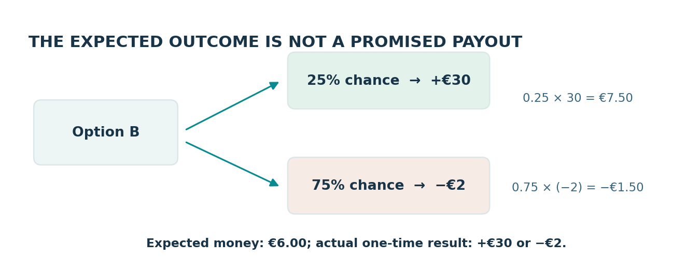

Suppose you're offered two choices. Option A guarantees a gain of €6. Option B offers a 25 percent chance of gaining €30 and a 75 percent chance of losing €2. The <strong>expected monetary value</strong> of B is 0.25 × 30 + 0.75 × (−2) = €7.50 − €1.50 = <strong>€6</strong>. The two options have the same expected money, but their outcomes feel different. In A the result is certain; in B, you lose money three out of four times. If you play once, you never actually receive “the expected €6” from B. That number is an average across the possible outcomes, not a promised result.

Expected value is calculated by multiplying each possible outcome by its probability and adding the results. If outcomes are x₁, x₂, and so on, with probabilities p₁, p₂, and so on, the expected value is the sum of each p × x. The weights should cover all mutually exclusive outcomes and total 100 percent. For a simple game where you win €12 with probability 0.4 and lose €5 with probability 0.6, expected gain = 0.4 × 12 + 0.6 × (−5) = €1.80. Whether you should enter depends on more than the mean: the number of opportunities, the stakes, your budget, and the reliability of the probabilities matter.

Consider a business ordering extra stock for a local event. If the event is busy (probability 0.3), the extra stock produces €450 in <strong>additional net profit</strong>. If attendance is ordinary (probability 0.7), leftover inventory and costs create a €120 <strong>net loss</strong>. Expected net outcome is 0.3 × 450 + 0.7 × (−120) = €135 − €84 = <strong>€51</strong>. If those numbers are reliable and the decision can be repeated, the gamble has positive expected monetary value. But a single merchant might rationally avoid it if cash is tight or stock cannot be returned. The calculation informs the decision; it does not make it for you.

<figure class="figure" id="figure-3-4">

<figcaption>Figure 3.4. The expected monetary outcome is a probability-weighted average, not a certain payout. <a class="figure-anchor" href="#figure-3-4" aria-label="Link to this figure">#</a></figcaption>
</figure>

An expected value can also conceal how widely results vary. Imagine a choice that pays €1,000 with a one-in-a-thousand chance and loses €1 otherwise. Its expected outcome is near zero, but most people experience the loss. A positive average is not automatically a good household plan, particularly if the gains are rare, the stakes cannot be repeated, or the worst outcome threatens basic needs.
