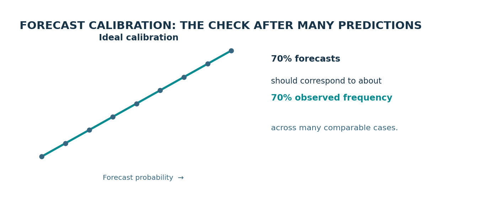

Suppose a forecaster predicts a 60 percent chance of an event on a large collection of comparable occasions. If that forecast is <strong>calibrated</strong>, the event should occur about 60 percent of the time among those occasions, given a sufficiently large and suitable sample. Calibration tells us whether stated probabilities match observed frequencies. A forecaster who repeatedly predicts 90 percent and is right only 50 percent of the time is overconfident; someone who predicts 50 percent for almost everything may avoid extreme mistakes but offer little discrimination between easy and hard cases.

Calibration and <strong>sharpness</strong> answer different questions. Calibration is about honesty of the numbers over repeated cases. Sharpness concerns how informative or decisive the forecasts are—whether they meaningfully distinguish low- from high-probability situations rather than clustering safely around 50 percent. An excellent forecast aims to be both well calibrated and usefully discriminating. A model that says 50 percent for every genuinely balanced situation can be good; a model that says 50 percent even when some events are virtually certain is not doing its job.

<figure class="figure" id="figure-3-6">

<figcaption>Figure 3.6. Calibration compares many forecasts with observed frequencies; schematic, not empirical data. <a class="figure-anchor" href="#figure-3-6" aria-label="Link to this figure">#</a></figcaption>
</figure>

Weather forecasts make this concrete. In the U.S. National Weather Service terminology, probability of precipitation is the chance that a given point in the forecast area will receive a measurable amount of precipitation over a specified period. A 30 percent chance does <strong>not</strong> mean rain will fall for 30 percent of the hours, nor does it mean exactly 30 percent of the area must get wet. Always check which event, point, and period your forecast refers to. Different providers may express forecasts in different ways, so definitions matter.

Public policy, elections, and business forecasts are harder to judge. Events may be rare, unique, or changed by the forecast itself. If people hear that a company may fail, their reactions can contribute to its failure; if they hear about an impending shortage, they may buy more immediately. Even so, one outcome is not enough to prove that a probability was bad. The best evaluation uses many comparable forecasts, transparent definitions, and honest records of what was predicted before the result was known.
