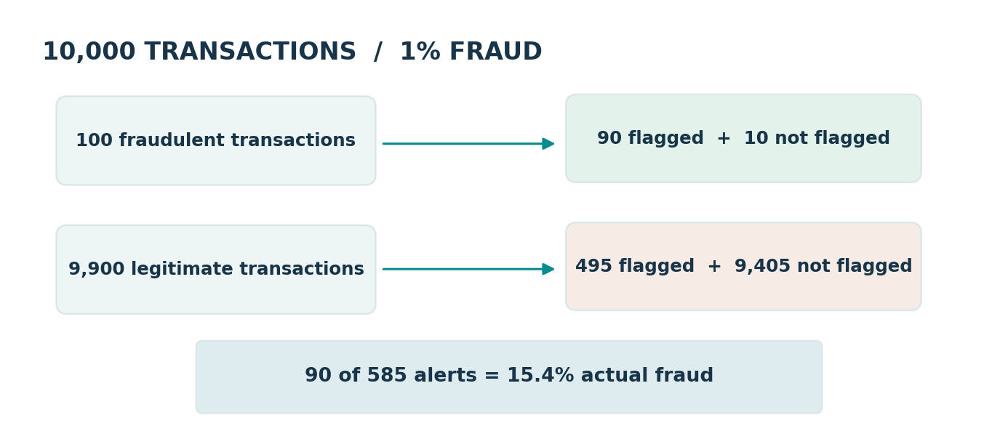

Return to the opening story. Imagine exactly 10,000 transactions, with 1 percent fraudulent: 100 frauds and 9,900 legitimate purchases. The detection system flags 90 percent of frauds, so it correctly catches 90. It mistakenly flags 5 percent of legitimate purchases, which is 495 honest transactions. In total, 585 transactions receive alerts, but only 90 of them are fraudulent.

That makes the probability of actual fraud <strong>among the flagged transactions</strong> equal to 90 / 585, or about <strong>15.4 percent</strong>. Far from saying “the buyer is 90 percent likely to be a fraudster,” the evidence says that around 84.6 percent of flagged customers in this hypothetical population are legitimate. The detector still caught nine out of ten frauds; its problem is that the non-fraud population is much larger.

<figure class="figure" id="figure-3-2">

<figcaption>Figure 3.2. A reliable detection rate does not imply a reliable positive prediction when fraud is rare. <a class="figure-anchor" href="#figure-3-2" aria-label="Link to this figure">#</a></figcaption>
</figure>

The 1 percent starting prevalence is called the <strong>base rate</strong>. It affects the meaning of a positive signal. Suppose we used the same detection system in a very different environment, where 10 percent of transactions were fraudulent. Out of 10,000, there would be 1,000 frauds and 9,000 legitimate purchases. The system would flag 900 frauds and 450 legitimate purchases, so 900 / 1,350 = 66.7 percent of alerts would indicate actual fraud. The software did not change; the population did.

This is one way to understand <strong>Bayes' rule</strong>: new evidence updates a starting probability, and the result depends both on the evidence's quality and on how common the event was beforehand. You do not have to memorize the equation to grasp the essential principle: a rare event requires especially convincing evidence before it becomes likely in an individual case. The equation, for a positive signal S and a target event T, is P(T \| S) = \[P(S \| T) × P(T)\] / P(S). The natural-frequency method above is the same logic expressed as counts.

<strong>Important limits.</strong> Real screening systems can have changing performance across populations. Fraud prevalence may shift across countries, times, payment methods, or merchants. Users can behave strategically. “False-positive rate” must be clearly defined, and any statement about an individual is conditional on the model matching their situation. A risk flag should prompt the next sensible investigation, not a declaration of guilt.
