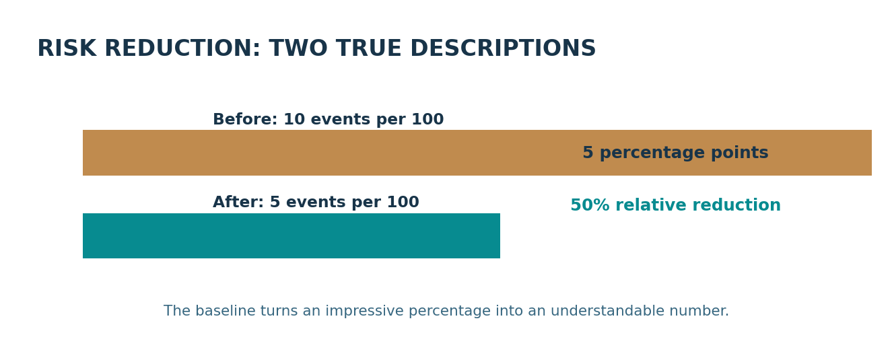

Suppose a hypothetical treatment lowers the chance of an adverse event from 10 percent to 5 percent in a certain group during a fixed period. It reduced risk by <strong>5 percentage points</strong>. It also reduced risk <strong>by 50 percent relative to the original risk</strong>. These descriptions are not contradictory; they frame different features of the same result. The absolute difference answers “how many additional events per 100 people might be avoided?” The relative difference answers “what fraction of the original risk was removed?”

Now change the starting risk: from 2 events per 10,000 to 1 per 10,000. This is again a 50 percent relative reduction, but only a one-event-per-10,000 absolute reduction. A headline promising to “halve your risk” would sound the same in both situations, even though the number of people affected is very different. When evaluating a claim, insist on <strong>both</strong> the relative number and the baseline or absolute number.

In research you may also meet the <strong>number needed to treat</strong>, or NNT, an estimate of how many people would need a particular intervention, during a specified period and in a specified population, to prevent one additional event compared with a comparator. In the first hypothetical example, the absolute risk reduction is 0.05, so NNT = 1 / 0.05 = 20. This is a population average under the study's conditions, not a prediction that precisely one of every 20 named people will personally benefit. NNT can vary with time period, baseline risk, and population. It should be weighed alongside adverse effects, cost, and evidence quality.

Risk is not only probability. An event with a one-in-a-thousand chance of a minor inconvenience deserves a different response from a one-in-a-thousand chance of permanent injury. For high-consequence decisions, we should also consider how uncertain the probability estimate itself is. Someone who tells you an extreme event has “a 0.01 percent chance” without credible evidence may be displaying false precision. A probability can be a useful estimate and still be poorly known.

<figure class="figure" id="figure-3-3">

<figcaption>Figure 3.3. Report absolute and relative change together, always identifying the baseline. <a class="figure-anchor" href="#figure-3-3" aria-label="Link to this figure">#</a></figcaption>
</figure>
