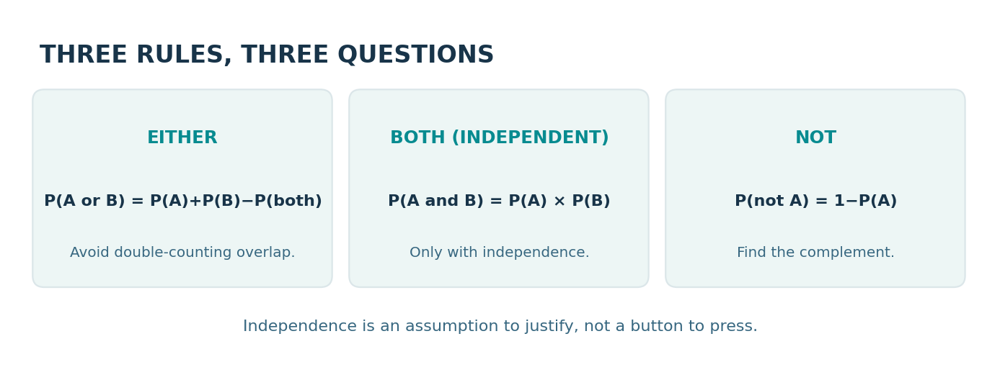

Probability is often taught through coins and dice because we can define the possible outcomes precisely. Consider a fair die. The probability of rolling a 1 or a 2 is 2/6 = 1/3, because the two outcomes are mutually exclusive: they cannot both occur on the same roll. More generally, if events A and B cannot happen together, P(A or B) = P(A) + P(B). If events can overlap, we subtract the overlap once: <strong>P(A or B) = P(A) + P(B) − P(A and B)</strong>.

Now imagine tossing two fair coins. There are four equally likely ordered outcomes: HH, HT, TH, and TT. The chance of two heads is 1/4, or 25 percent. For independent events, knowing the outcome of one does not change the probability of the other, so we multiply: <strong>P(A and B) = P(A) × P(B)</strong> when A and B are independent. For two heads, 1/2 × 1/2 = 1/4.

Independence is not the same as mutually exclusive. Two different coin tosses can both show heads; those events can co-occur and, under our model, are independent. “A single die shows 2” and “the same die shows 5” cannot co-occur; they are mutually exclusive but not independent. If an event with positive probability has occurred, a mutually exclusive alternative becomes impossible. Confusing these terms leads to incorrect calculations and worse predictions.

There is one more practical shortcut: the <strong>complement</strong>. If the chance of missing a train is 15 percent, the chance of not missing it is 85 percent, assuming these outcomes cover all possibilities. This is 1 − P(missing). More complicated events can sometimes be solved by calculating the opposite first. If a device has a 10 percent independent chance of failing on each of three attempts, the chance it fails all three times is 0.1³ = 0.001, or 0.1 percent; the chance of at least one success is 99.9 percent. Such calculations depend critically on the independence assumption.

<figure class="figure" id="figure-3-1">

<figcaption>Figure 3.1. Three probability operations answer different questions; assumptions matter. <a class="figure-anchor" href="#figure-3-1" aria-label="Link to this figure">#</a></figcaption>
</figure>

<strong>A check before you multiply.</strong> If three deliveries are delayed by the same snowstorm, their outcomes are not necessarily independent. If a machine's faults come from a shared electrical problem, three backups powered by the same circuit may fail together. Multiplying marginal failure probabilities as if each event were independent can make a dangerous system look far safer than it is.
