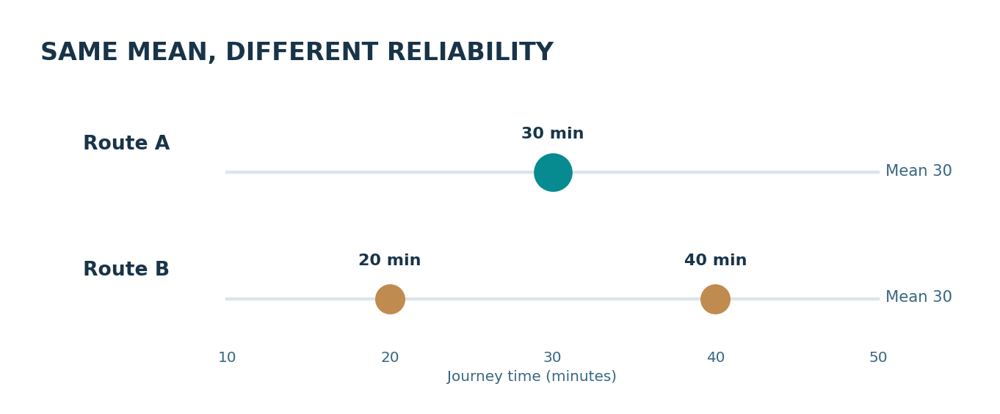

Imagine two bus routes between villages. Route A takes exactly 30 minutes each day. Route B takes 20 minutes on half of days and 40 minutes on the other half. Both have an average travel time of 30 minutes. But if you have a critical appointment in 35 minutes, Route A is much safer. If arriving in 20 minutes is especially valuable and being late has little consequence, you may prefer Route B. The <strong>mean</strong> describes the centre of a distribution, not its spread.

A <strong>distribution</strong> tells us which outcomes are possible and how frequently they appear. The <strong>variance</strong> and its square root, the <strong>standard deviation</strong>, summarize how far observations typically spread around the mean. You do not need to calculate these by hand in every situation. At a minimum, ask for the range of likely outcomes, the unusual extremes, and whether one poor outcome matters far more than a good one. Some risks are driven by rare but costly <strong>tails</strong> of a distribution that a simple average hides.

In many natural and social settings, outcomes cluster around a centre. In others they are strongly skewed. Consider household wealth. A few exceptionally wealthy households can pull the average upward while the median household—half above it and half below—has far less. Or consider natural disasters. Most years might be relatively calm, with a small number of extraordinary years contributing a large share of total losses. An average year can be a poor picture of what a bad year demands.

<figure class="figure" id="figure-3-5">

<figcaption>Figure 3.5. Two routes share a mean travel time yet differ in variability and lateness risk. <a class="figure-anchor" href="#figure-3-5" aria-label="Link to this figure">#</a></figcaption>
</figure>

It is easy to confuse the average of an observed sample with the expected value in a probability model. They are related but not identical. A sample average is what actually happened in the observed cases; expected value summarizes what the model predicts in the long run. Sometimes sample averages approximate model expectations well. Sometimes the sample is too small, biased, or drawn from a changing process. A good analyst asks what process generated the numbers before drawing conclusions from their centre.
