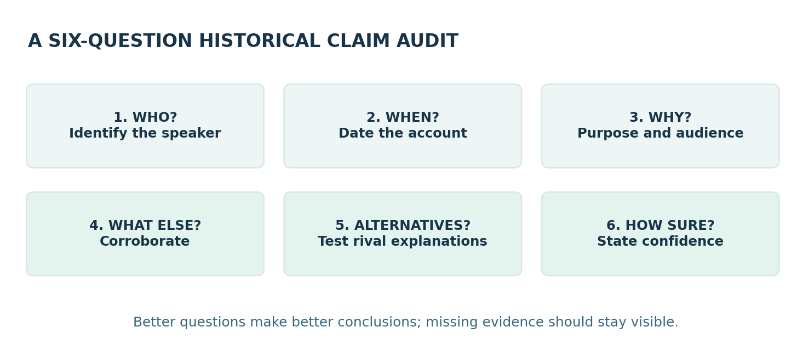

To see the method in miniature, imagine someone posts a claim: “A famous medieval ruler abolished all taxes for ordinary people.” Rather than starting with “true” or “false,” define the question. Which ruler, which region, what dates, which kinds of taxes, and what does “ordinary people” mean in the political system involved? Once the terms are precise, investigate the <strong>origin of the claim</strong>. Did it first appear in a contemporary decree, a much later chronicle, a modern popular book, or an unsourced online video?

Next locate the best surviving evidence. A royal order, if authentic, might show an intended policy but not guarantee implementation. Tax accounts could reveal what was actually collected, where such records survive. Complaints and legal disputes might reveal exceptions, enforcement failures, and resistance. A neighboring polity's diplomatic correspondence might provide an independent description, though not necessarily an unbiased one. A finding that “some levies were suspended during one crisis” would be very different from “all taxes were permanently abolished.”

<figure class="figure" id="figure-4-8">

<figcaption>Figure 4.8. A practical workflow for investigating historical claims without pretending to certainty. <a class="figure-anchor" href="#figure-4-8" aria-label="Link to this figure">#</a></figcaption>
</figure>

Then form the most cautious explanation supported by the available evidence. Perhaps the ruler suspended one levy for a particular district for a limited period. Perhaps a chronicler celebrated that as generous rule, and later writers enlarged the story. Perhaps the available records are too thin to answer. A disciplined account states not only its conclusion but the evidence, the limits of the evidence, and an indication of confidence. It does not need dramatic uncertainty about everything; it needs precision about the claims that remain uncertain.

Here is a practical six-question habit for any historical assertion: <strong>Who says it? When was that account created? What was the author trying to do? What independent evidence exists? What alternative explanation fits the evidence? How certain should we be?</strong> Most public historical misunderstandings become easier to examine once these six questions are made explicit.
