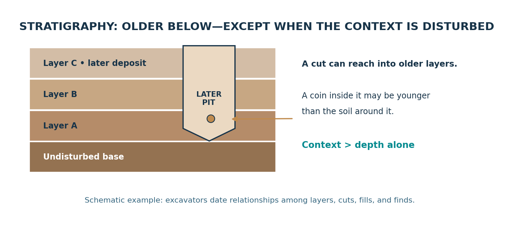

Imagine digging beneath the floor of a ruined house and finding a layer of ash, broken pottery, and animal bones. The temptation is to announce that a dramatic fire destroyed the entire settlement. Yet the ash might come from a hearth, a local accident, or an intentional burning episode; the objects could have accumulated across many years. Archaeology turns physical traces into historical understanding by recording context carefully before interpreting what the remains mean. The location of an object may be as important as the object itself.

A fundamental archaeological principle is <strong>stratigraphy</strong>. In undisturbed sequences, lower deposits generally formed before the deposits above them. But this is a <em>relative</em> ordering, not a guarantee that every deeper object is older. Burrowing animals, later pits, building repairs, erosion, plowing, and human activity can move material around. A deep grave may cut through older layers and contain relatively recent objects. A coin dropped into a crack might migrate below the surface. The archaeologist studies the relationships among layers, cuts, fills, walls, and objects rather than trusting depth alone.

<figure class="figure" id="figure-4-3">

<figcaption>Figure 4.3. Stratigraphic context matters more than depth alone; a later cut can contain younger objects. <a class="figure-anchor" href="#figure-4-3" aria-label="Link to this figure">#</a></figcaption>
</figure>

Archaeological context must be documented because excavation is partly destructive. Once a layer is removed, its precise relationships cannot be restored. Archaeologists therefore record plans, photographs, coordinates, soil characteristics, finds, and where samples came from. They may study seeds, pollen, charcoal, animal teeth, tool wear, microscopic residues, or ancient DNA. Each type can illuminate a different question: diet, agricultural practice, craft production, environmental change, movement, or kinship. Results become more compelling when they agree across independently collected forms of evidence.

A pottery fragment need not carry a written label to be historically useful. Its shape, manufacturing technique, decoration, and chemical composition may suggest when and where it was made; comparison with securely dated assemblages may narrow the possibilities. Imported objects may indicate contact, but we must not jump from “foreign object” to “foreign army” or assume a merchant personally traveled the object's entire route. Goods could change hands many times. Archaeological evidence supplies constraints on an explanation; it does not automatically narrate the people involved.

A building's scale can suggest the organization of labor and resources, but size alone cannot tell us a ruler's personal beliefs. Skeletal evidence may reveal injuries or dietary stress without telling us exactly what an individual said or thought. The strongest archaeology is rigorous about those distinctions. When somebody claims that one spectacular artifact “proves an entire civilization was founded by outsiders,” pause. Ask about the stratigraphic context, the dating, the comparison with local material culture, and the much larger pattern. The finding may matter. The proposed story still needs evidence.
