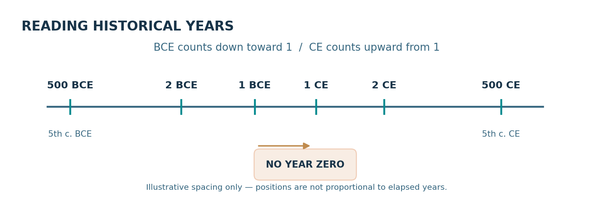

Modern global reference books commonly use <strong>BCE</strong> (“Before Common Era”) and <strong>CE</strong> (“Common Era”) to label years in the same numerical system as <strong>BC</strong> and <strong>AD</strong>. BCE years count backward as one approaches the conventional start of the era; CE years count forward. Crucially, ordinary historical year numbering goes directly from 1 BCE to 1 CE. <strong>There is no year zero.</strong> That matters when calculating intervals that cross the boundary. From the beginning of 1 BCE to the beginning of 1 CE is one year, not two.

A “century” is also a counting convention, not a magical breakpoint in human affairs. The first century CE is years 1–100, the second is 101–200, and the twentieth is 1901–2000. The fifth century BCE is 500–401 BCE. “Early fifth century BCE” means a time closer to 500 BCE, not to 401 BCE. If you read that the classical Greek historian Herodotus wrote in the fifth century BCE, you should picture the 400s BCE and orient his work relative to the Persian Wars, not assume the same social world as the Roman Empire hundreds of years later.

<figure class="figure" id="figure-4-1">

<figcaption>Figure 4.1. BCE/CE historical notation contains no year zero; schematic spacing is not to scale. <a class="figure-anchor" href="#figure-4-1" aria-label="Link to this figure">#</a></figcaption>
</figure>

Civilizations have used different calendars, and many still use traditional or religious calendars alongside civil dating. An Islamic Hijri year, for example, belongs to a lunar calendar whose epoch is tied to the Hijra in 622 CE; because lunar years are shorter than solar years, simply subtracting 622 does not give an accurate conversion. A regnal record might date an event to the fourth year of a king rather than to an absolute CE year. An ancient inscription might describe a festival or season rather than a numbered day. Calendar conversion often requires knowledge of local practice, accession-year rules, and whether dates are inclusive.

Even within European history, conversion matters. The Julian calendar accumulates a small error relative to the seasons; the Gregorian reform began in 1582 and was adopted in different places at different times. In places making the original switch in October 1582, Thursday 4 October was followed by Friday 15 October. The elapsed days did not disappear from reality; the numbering jumped. Other regions changed later and by different numbers of calendar days. If you see two apparently conflicting dates for the same event, check whether one uses the Julian (“Old Style”) and the other the Gregorian (“New Style”) calendar.

The familiar “October Revolution” in Russia occurred in October 1917 by the Julian dates then used in Russia, but in November on the corresponding Gregorian dates. The name did not become wrong when the calendar changed. Similarly, a Bulgarian historical date preserved by a national commemoration may need a calendar annotation before comparison with Western European diplomatic dispatches. The safe practice is to record the <strong>original date as given</strong>, the <strong>calendar used if known</strong>, and any <strong>converted date</strong>, rather than silently mixing systems. The historian's calendar is a translation tool, and translations can be mishandled.
