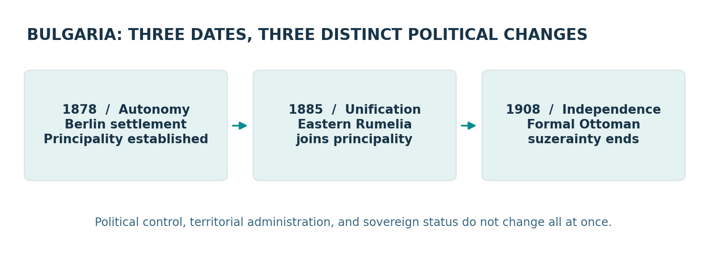

For a familiar example of chronology and political interpretation, consider three dates: <strong>1878, 1885, and 1908</strong>. They all belong to the formation of modern Bulgaria, but they refer to different kinds of change. Treating them as interchangeable would erase some of the most important political mechanisms in the story.

In 1878, the Russo-Turkish War ended and a preliminary peace treaty was signed at San Stefano in March. The diplomatic settlement was revised by the <strong>Treaty of Berlin in July 1878</strong>, establishing a smaller autonomous Principality of Bulgaria under Ottoman suzerainty and an autonomous province of Eastern Rumelia with a different legal status. Other territories remained under direct Ottoman administration. The exact arrangements were products of war, negotiation, and competing great-power interests. Calling 1878 “liberation” captures a central theme of Bulgarian national memory, but the diplomatic and legal map produced that year was more complicated than the label alone suggests.

In <strong>1885</strong>, political action in Eastern Rumelia and support from the Bulgarian principality brought unification of the two territories. The event reshaped practical governance and the political situation, but it did not yet erase the principality's formal status under the treaty system. In <strong>1908</strong>, Prince Ferdinand proclaimed Bulgaria's full independence at Tarnovo and adopted the title of tsar. That declaration ended the remaining formal Ottoman suzerainty, and subsequent international negotiations helped secure recognition. The proclamation was not a magic act detached from diplomacy, military readiness, Ottoman politics, and the interests of other European powers.

<figure class="figure" id="figure-4-7">

<figcaption>Figure 4.7. Bulgaria’s autonomy (1878), unification (1885), and independence (1908) were distinct changes. <a class="figure-anchor" href="#figure-4-7" aria-label="Link to this figure">#</a></figcaption>
</figure>

Why is this a useful historical case? It demands several distinctions: territorial control versus legal status, the actions of nationalist movements versus the decisions of great powers, political declaration versus diplomatic recognition, and national commemoration versus full causal explanation. A legal text can tell us what a treaty stipulated; administrative records can tell us how an area was governed; newspaper coverage can reveal how different audiences understood events. A more sophisticated account places them alongside one another.

There is also a calendar caution. Dates in older Bulgarian and other regional records may use the Julian calendar; later publications sometimes convert or commemorate dates in ways readers must identify explicitly. Do not assume that every historical source using the same month and day uses the same dating system. Our purpose is not to deny the importance of the commemorated events. It is to see them with enough precision that they connect into a coherent history instead of three isolated facts.
