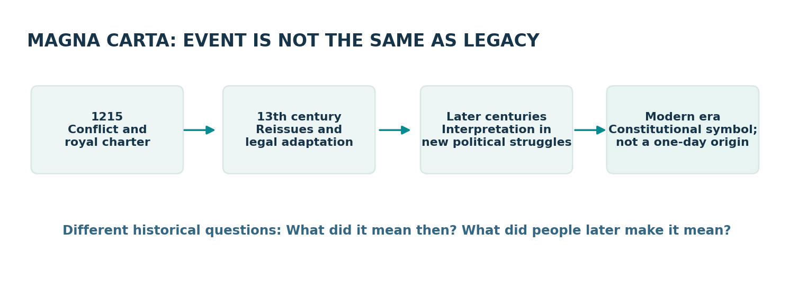

Return to England in 1215. King John faced opposition from barons dissatisfied with his rule and demands. The settlement later called Magna Carta attempted to address grievances and establish constraints expressed through the legal and political arrangements of the age. It did not put Britain on an uninterrupted straight road to modern democracy. Civil conflict continued; the charter was annulled and later reissued in revised forms. The fact that the document survived politically was a story of later reinterpretation, not a single triumphant signing.

Start with what the <strong>sources</strong> can show. The surviving 1215 originals are tangible evidence of the agreement's text and dissemination. Later reissues reveal that the text was not fixed forever. Records of political disputes and later legal commentaries illuminate how the charter's meaning changed. Parliamentary and judicial traditions developed through many other struggles and institutions. If we want to understand what people in 1215 meant by a clause, we should read it in the context of medieval law and the particular conflict—not in the language of an imagined twenty-first-century human rights charter.

That does not reduce its importance. A text can acquire new significance as later generations select, debate, and reinterpret it. Ideas about lawful government and constraints on rulers could draw legitimacy from Magna Carta even when later speakers gave it meanings different from those familiar to its first audience. The distinction to preserve is between <strong>original function</strong> and <strong>subsequent legacy</strong>. Neither can substitute for the other.

<figure class="figure" id="figure-4-6">

<figcaption>Figure 4.6. The immediate political purpose of Magna Carta and its later constitutional legacy differ. <a class="figure-anchor" href="#figure-4-6" aria-label="Link to this figure">#</a></figcaption>
</figure>

This case also teaches a lesson about copies and originals. We often equate “original” with a singular object, but medieval administrative writing could produce several authoritative copies for distribution. Provenance, handwriting, seals, and textual variants help scholars reconstruct how those documents were made and transmitted. A museum display inviting you to admire a parchment may be a good starting point; the historian's questions begin as you ask why this copy exists, which version it is, and how it reached the archive.
