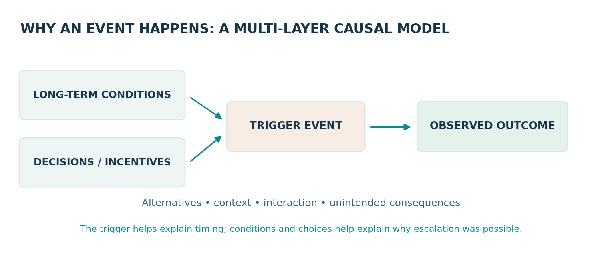

People often ask, “What caused the war?” or “Why did this empire collapse?” and expect a single answer. Yet historical outcomes usually emerge from several different kinds of causes. A <strong>trigger</strong> is an event that helps set a crisis in motion. <strong>Structural conditions</strong> are slower forces such as institutional weakness, long-term rivalry, resource pressures, debt, technological change, or social inequality. <strong>Human choices</strong> determine how actors respond within those conditions. A trigger without structural context may explain timing but not the larger vulnerability. Structural context without human agency may make the outcome sound inevitable when it was not.

A famous example is the outbreak of the First World War. The assassination of Archduke Franz Ferdinand in Sarajevo in June 1914 was an important trigger. Yet the larger war cannot be explained by the assassination alone. Diplomatic alignments, imperial rivalry, mobilization plans, leaders' decisions, nationalism, fears of strategic disadvantage, and the escalation of the July Crisis all enter serious explanations. Historians disagree about relative responsibility and the weight to assign to these factors. That disagreement is not simply confusion about whether the assassination happened; it concerns complex causation.

A careful causal explanation names <strong>mechanisms</strong>. “Nationalism caused the conflict” is too vague without specifying which organizations, ideas, policies, or pressures connected nationalist claims to the decisions of governments and armies. “Economic weakness caused the revolution” is incomplete unless we show how prices, employment, tax capacity, grievances, or elite alliances affected action. The same factor can have different effects in different contexts. Economic crisis may destabilize one regime while strengthening another government's support if the public trusts its response.

<figure class="figure" id="figure-4-5">

<figcaption>Figure 4.5. Outcomes arise from interactions among long-term conditions, choices, and triggers. <a class="figure-anchor" href="#figure-4-5" aria-label="Link to this figure">#</a></figcaption>
</figure>

Three habits improve causal reasoning. First, distinguish <strong>necessary conditions</strong> from <strong>sufficient conditions</strong>: something may have been important without alone producing the result. Second, consider <strong>interaction</strong>: a failed harvest may become a political crisis because the government cannot import food or respond credibly. Third, ask what would have happened if one condition differed. Such <strong>counterfactual questions</strong> cannot be tested by replaying history, but carefully limited comparisons help reveal which mechanisms are plausible. The danger lies in making counterfactual fantasy sound like evidence.

History also has <strong>unintended consequences</strong>. Reforms may produce opposition, victories may create overextension, and new communication networks may strengthen the very movements a government seeks to suppress. Always separate what decision-makers wanted from what actually happened. The past is full of people acting with limited information, within institutions they did not entirely control, toward outcomes they could not fully foresee.
