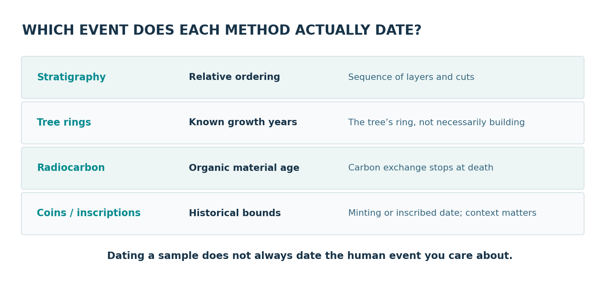

Not every historical question comes with a date written in a surviving document. Researchers often have to build a chronology from physical evidence. There are two broad kinds of answers. <strong>Relative dating</strong> says one event or object is older than another. <strong>Absolute or chronometric dating</strong> estimates an age in years or within a calendar range. A trustworthy reconstruction frequently combines both.

Tree-ring dating, or <strong>dendrochronology</strong>, matches patterns of ring growth among trees of overlapping ages. In favorable conditions, a securely matched sequence can identify the calendar year in which a tree ring formed. Yet a timber's final preserved ring may not be the tree's felling year if outer rings are missing, and a reused beam can be much older than the building that contains it. The wood dates a tree's growth, not automatically the construction or abandonment of a site. That distinction sounds technical until you realize it can change an entire historical timeline.

<strong>Radiocarbon dating</strong> measures the remaining radioactive carbon-14 in once-living material. When an organism stops exchanging carbon with its environment, carbon-14 gradually decays. Its physical half-life is approximately 5,730 years, meaning that, under the simplest model, about half the original radiocarbon remains after that period. Radiocarbon dating commonly helps date archaeological material up to roughly 50,000 years old, although the practical range and reliability depend on the sample and method. It cannot directly date an ordinary stone block simply because the block is ancient; it can sometimes date organic material associated with the construction.

Here is the crucial complication: a radiocarbon <strong>measurement</strong> is not an automatically precise <strong>calendar date</strong>. Standard conventional radiocarbon ages retain the historically used Libby half-life and express years “BP,” where “present” conventionally means <strong>1950</strong>, not the current year. Atmospheric radiocarbon concentrations have changed over time, so measured ages need <strong>calibration</strong> against materials of known date, such as established tree-ring sequences. Laboratory measurement uncertainty and archaeological context both matter. A calibrated result may describe one or more probability ranges rather than a single exact year.

<figure class="figure" id="figure-4-4">

<figcaption>Figure 4.4. Dating techniques constrain different events and require different assumptions. <a class="figure-anchor" href="#figure-4-4" aria-label="Link to this figure">#</a></figcaption>
</figure>

Dating can go wrong for recognizable reasons. Wood burned in a hearth might have come from the heartwood of a centuries-old tree: the <strong>old-wood effect</strong> makes the dated growth older than the fire. A sample contaminated by modern carbon can appear too young. Marine or freshwater <strong>reservoir effects</strong> can produce misleading results if the carbon in a food chain has a different radiocarbon history from the atmosphere. A charred seed from a sealed context may date a short-lived plant more directly than charcoal from an old timber. Good researchers explain sample selection and likely error sources rather than hiding them beneath a precise-looking year.

Other techniques answer other questions. Coins or historically dated inscriptions may supply <strong>termini</strong>—limits such as “this layer cannot predate this coin's minting.” Thermoluminescence or optically stimulated luminescence may estimate when certain minerals were last heated or exposed to light, under appropriate conditions. Geological and astronomical evidence can sometimes provide additional constraints. The practical lesson is not to learn every laboratory technique, but to ask: <strong>What event has actually been dated—the object's manufacture, its last use, the death of an organism, the filling of a pit, or the building's occupation?</strong> A result is only as useful as that relationship.
