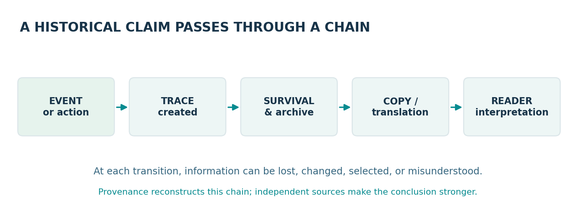

History survives unevenly. A stone inscription may last millennia; a conversation may vanish within an hour. A palace can leave foundations and tax records; a laborer's daily efforts may survive only indirectly, in a discarded tool, a food residue, a burial, or a land survey. Writing was not equally available to everyone. Those with power could commission monuments, keep bureaucratic accounts, and determine which laws entered official archives. Enormous numbers of human experiences were never recorded in writing and cannot be reconstructed in the same detail as the deeds of rulers.

Historians call surviving materials <strong>sources</strong>. Written texts are familiar: letters, laws, contracts, court records, poems, diplomatic dispatches, newspaper reports, diaries, and account books. But sources can also be objects, bones, buildings, photographs, landscapes, languages, oral histories, songs, coins, tree rings, shipping manifests, or digital files. The source is not the past itself. It is something that survives from or comments on the past and might help answer a particular question.

<figure class="figure" id="figure-4-2">

<figcaption>Figure 4.2. From a past event to a modern interpretation: provenance is a chain of decisions and survivals. <a class="figure-anchor" href="#figure-4-2" aria-label="Link to this figure">#</a></figcaption>
</figure>

Every source has a history of its own. A letter was produced under particular conditions; it may have been folded, delivered, copied, translated, damaged, deliberately destroyed, or preserved in a private family archive. A later historian might see only a printed excerpt. If a quotation from a letter appears in a modern article, the path from event to claim may run through multiple decisions: what the author chose to write, what survived, what an editor transcribed, how it was translated, and what the article selected. Following that chain is called studying <strong>provenance</strong> and <strong>transmission</strong>.

This explains why evidence can be authentic without being complete. The very existence of a royal tax register may strongly indicate that a government tried to count certain obligations, but it cannot automatically tell us every obligation that was collected in practice. A military report may be a genuine original and still contain mistaken casualty estimates. An old photograph may capture real people and a real street without proving the caption now attached to it. Authenticity establishes something important about a source; it does not guarantee the truth of every statement we derive from it.

We also need to recognize <strong>survivorship bias</strong>. The material we possess is the result of both past activity and the accidents or policies of preservation. If a library burned, we might know far less about its society than about another that retained its records. A dramatic monument may be easier to study than the homes of the people who built it. Historians respond by combining evidence types, looking for traces of ordinary life, investigating who is missing from records, and resisting arguments built entirely on the materials that were easiest to preserve.
