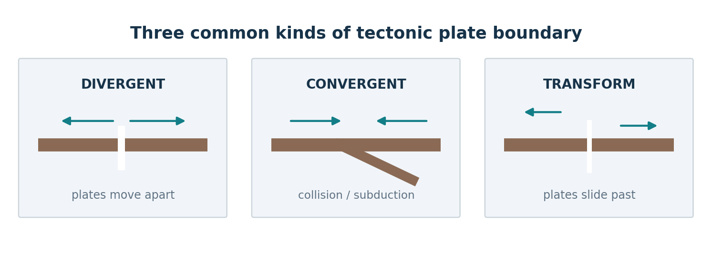

If we could accelerate geological time, continents would not sit still. The Earth's rigid outer shell—the <strong>lithosphere</strong>—is divided into moving tectonic plates. Plates may move apart at divergent boundaries, collide or converge at other boundaries, or slide past one another at transform boundaries. Their relative motions typically amount to centimetres per year. Over millions of years, that is enough to open oceans, build enormous mountains, and redraw the positions of continents. Plate tectonics unifies many observations, including the geographic patterns of earthquakes and volcanoes. \[<a href="/005-geography-maps-and-scale/sources/#source-3" class="cite">3</a>\]

At a <strong>divergent boundary</strong>, magma can rise as plates separate; mid-ocean ridges help create new oceanic crust. At a <strong>convergent boundary</strong> where an oceanic plate descends beneath another plate, a <strong>subduction zone</strong> can generate powerful earthquakes, trenches, and volcanic arcs. Where two continents collide, thickened crust can rise into great mountain systems. The Himalayas reflect the long collision between the Indian and Eurasian plates. At a <strong>transform boundary</strong>, plates slide laterally past one another, as along sections of the San Andreas Fault system.

These are patterns, not absolute rules. Volcanoes can occur away from plate boundaries, and the details of local geology matter. The eruption of a volcano or the location of a particular earthquake cannot be predicted simply by pointing to a plate-boundary line. Scientists measure deformation, seismic activity, geological history, and many other variables to estimate hazards. A map of plate boundaries tells us where risk is commonly concentrated, not the precise date when a disaster will happen.

<figure class="figure" id="figure-5-4">

<figcaption>Figure 5.4. Idealized plate-boundary motions. Real geology varies by location and time. <a class="figure-anchor" href="#figure-5-4" aria-label="Link to this figure">#</a></figcaption>
</figure>

<strong>Topography</strong> means the shape and elevation of the land: peaks, ridges, plains, basins, valleys and slopes. Elevation influences temperature, drainage, vegetation, travel and agriculture. Higher ground is often cooler, but the precise temperature difference depends on weather and atmospheric conditions. Valleys can trap cold air or pollution. A plateau may offer level terrain at a high elevation while still experiencing thin air, seasonal cold or water shortages.

Mountains complicate movement and also create opportunities. Passes concentrate routes; elevated terrain can supply rivers fed by snow and rainfall; steep valleys may yield hydropower potential where water supply and engineering permit it. The Andes shape western South America's landscapes and climate, while the East African Rift system illustrates how stretching and faulting can form valleys and lakes. The geographical constraint is real, but societies respond with terraces, tunnels, roads, irrigation, and choices about where to build. Mountains are not destiny, and not all mountain populations are isolated.

A <strong>natural hazard</strong> is a potentially damaging process such as an earthquake, landslide, flood, volcanic eruption, drought, or severe storm. A <strong>disaster</strong> results when hazardous events interact with exposure and vulnerability. An earthquake in an unpopulated region and an earthquake beneath a densely built city may release similar physical energy but cause very different human losses. Building codes, emergency systems, poverty, governance, and land-use decisions affect the outcome. Physical geography explains the hazard; social geography helps explain who is harmed.
