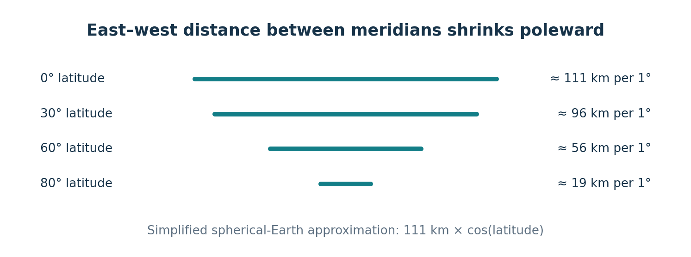

When you say that a place is “north of” another, you are using direction. When you say it lies at <strong>42 degrees north, 25 degrees east</strong>, you are using geographic coordinates. <strong>Latitude</strong> measures angular distance north or south of the Equator, from 0° to 90° in either direction. <strong>Longitude</strong> measures angular distance east or west of the prime meridian, conventionally measured through Greenwich, from 0° to 180°. Together they provide a coordinate address on or near the Earth, though a precise location may also require elevation and a reference datum.

Lines of latitude—<strong>parallels</strong>—run east-west, while lines of longitude—<strong>meridians</strong>—connect the poles. This creates a useful distance distinction. A degree of latitude is approximately 111 kilometres, varying modestly because the Earth is not a perfect sphere. At the Equator, one degree of longitude is also approximately 111 kilometres. At latitude 60°, it spans roughly half that distance, because the meridians converge toward the poles. A useful approximation for east-west distance is <strong>111 km × cos(latitude) per degree of longitude</strong>. At latitude 60°, cos(60°) = 0.5, yielding about 55.5 km. At the poles, all meridians meet. This is a simplified spherical-Earth calculation, not a substitute for survey-grade measurement.

<figure class="figure" id="figure-5-3">

<figcaption>Figure 5.3. Longitude spacing decreases toward the poles; simplified spherical distances shown. <a class="figure-anchor" href="#figure-5-3" aria-label="Link to this figure">#</a></figcaption>
</figure>

For distances between widely separated points, a spherical great-circle calculation uses the central angle between two locations. The usual estimate is <strong>distance ≈ Earth's mean radius × central angle in radians</strong>. Earth's mean radius is approximately 6,371 km; actual surveying uses a more accurate ellipsoidal model. You do not need to memorize geodesic formulas to read a map intelligently. You do need to recognize why an east-west degree is not a constant number of kilometres everywhere.

A <strong>datum</strong> describes the reference model and coordinate framework used to locate positions. GPS commonly uses WGS 84. Two maps based on different datums can place the same recorded coordinate slightly differently, which matters for high-precision surveying, engineering, and some navigation. Ordinary readers rarely need to compute datum shifts, but they should know that a latitude-longitude pair alone is not the entire technical story.

Coordinates also need units. The notation 42°30′ N means forty-two degrees and thirty <em>minutes</em> of arc, not thirty minutes of clock time. Sixty arcminutes make one degree. The same location in decimal degrees is 42.5° N. A decimal like 42.30° is not the same as 42°30′: 0.30° is only eighteen arcminutes. This distinction becomes critical when transcribing coordinates from one format to another.

A map's <strong>compass rose</strong> or north arrow describes orientation. Magnetic north and true (geographic) north differ by a location- and time-dependent magnetic declination. The compass points toward the magnetic field, not perfectly toward the geographic pole. Professional navigation therefore pays attention to declination and its changes, while most everyday digital maps quietly handle direction for the user.
