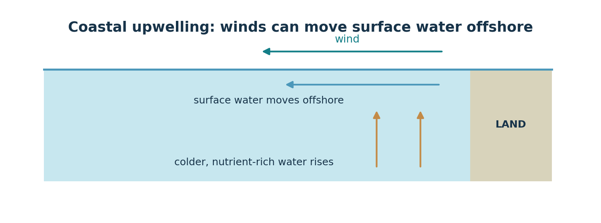

Oceans cover most of Earth's surface and connect continents more continuously than land routes do. Their surface currents are driven largely by winds, with Earth's rotation and coastline geometry influencing patterns; deep circulation also responds to differences in seawater density related to temperature and salinity. Currents transport heat, nutrients and organisms and help connect local climates to planetary processes. \[<a href="/005-geography-maps-and-scale/sources/#source-5" class="cite">5</a>\]

Imagine standing on a coast where winds move surface water away from the shore. Colder, nutrient-rich water may rise from depth to replace it. This is <strong>coastal upwelling</strong>, an important reason some marine regions support exceptionally productive fisheries. Parts of the eastern Atlantic and eastern Pacific are known for such systems. A coast can be near a desert and still support rich marine life, because rainfall on land and nutrient supply at sea respond to different processes. \[<a href="/005-geography-maps-and-scale/sources/#source-6" class="cite">6</a>\]

<figure class="figure" id="figure-5-8">

<figcaption>Figure 5.8. Conceptual upwelling diagram: offshore surface transport allows deeper water to rise. <a class="figure-anchor" href="#figure-5-8" aria-label="Link to this figure">#</a></figcaption>
</figure>

Historically, seas have been barriers and highways. The Mediterranean connects three continents and supported trading worlds with ports, routes, and cultural exchanges. The Indian Ocean allowed sailors to exploit seasonal winds, connecting East Africa, Arabia, South Asia, and Southeast Asia for centuries. The Atlantic later became central to major commercial, colonial, and forced-migration networks, including the transatlantic slave trade. Maritime access creates opportunities, but political power, ships, labour systems, financial institutions and coercion determine what people do with them.

A narrow strait or canal can be a <strong>chokepoint</strong>, a place where many routes pass through a limited corridor. The Strait of Malacca connects major Indian Ocean and Southeast Asian maritime routes; the Suez Canal links the Mediterranean with the Red Sea; the Panama Canal joins the Atlantic and Pacific sides of Central America; the Turkish Straits connect the Black Sea with the Mediterranean via the Sea of Marmara and Aegean Sea. Such places can reduce travel time while concentrating vulnerability. Alternative routes exist in some cases, but they often impose longer journeys or higher costs. \[<a href="/005-geography-maps-and-scale/sources/#source-7" class="cite">7</a>\]

Do not assume every ship uses one exact route or that a chokepoint's share of trade remains constant. Shipping depends on fuel prices, ship size, geopolitical conditions, insurance, water depth, weather and port facilities. The durable geographic insight is about the shape of the network: when many connections depend on a small number of passages, disturbances at those passages can spread far beyond the local region.
