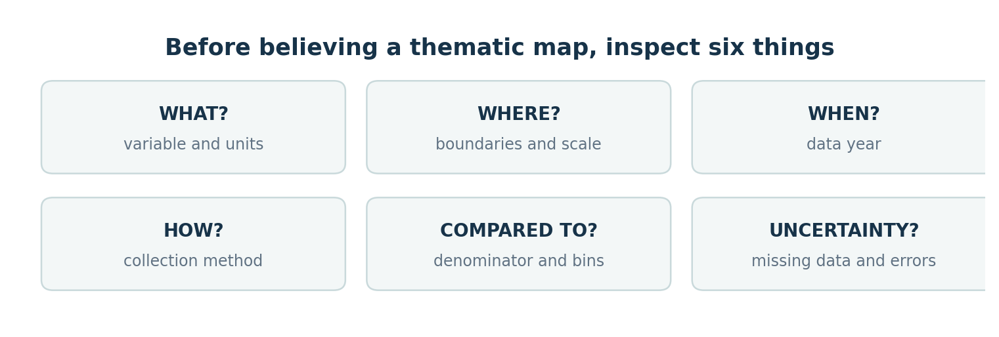

A <strong>thematic map</strong> shows the distribution of one subject: population density, rainfall, unemployment, language, election results or something else. Its colours may be compelling, but the map has many hidden statistical choices. A <strong>choropleth map</strong> colours geographic units according to values—districts by median income, for example. Areas with more land occupy more visual space even when they contain fewer people. This can cause a sparsely populated district to dominate a map while a dense city occupies only a tiny patch.

If you colour provinces by <em>total</em> thefts, large or populous provinces may appear to have more crime simply because they contain more people. Rates per resident might answer a different question; a map of local hotspots might reveal differences inside provinces. Similarly, a population map coloured by the number of inhabitants is not the same as a population-density map. Always ask for the denominator.

Two technical ideas are worth recognizing. The <strong>modifiable areal unit problem (MAUP)</strong> means statistical patterns can change when data are grouped into different-sized or differently drawn geographic units. The <strong>ecological fallacy</strong> occurs when an average relationship observed for a region is incorrectly attributed to individuals inside it. If wealthy districts have high rates of public transport use, it does not follow that the wealthiest individuals use public transport most often. Regional patterns do not automatically establish individual behaviour.

A map must also have a <strong>legend</strong>, date, data source, and preferably a clear note about uncertainty. Class breaks can exaggerate or conceal variation; two maps of identical data can look different if one uses equal intervals and another uses quantiles. Colours can imply moral judgments when red is used for “bad” and green for “good” without explanation. A precise-looking map may rely on estimates, incomplete surveys, or disputed classifications. Map literacy is partly numerical literacy, linking this chapter back to Chapters 3 and 6.

<figure class="figure" id="figure-5-9">

<figcaption>Figure 5.9. Six questions for inspecting the evidence and visual choices behind thematic maps. <a class="figure-anchor" href="#figure-5-9" aria-label="Link to this figure">#</a></figcaption>
</figure>

Modern <strong>geographic information systems (GIS)</strong> combine layers of spatial data to analyze questions such as flood exposure, travel time to hospitals, habitat change, infrastructure needs, and regional population trends. Remote sensing from satellites and aircraft provides observations of land cover, sea-surface temperature, vegetation, ice, topography and other features. These observations are powerful but require interpretation: a satellite image is not a magic proof of what caused a change on the ground. Sensors have resolutions and error; clouds obscure optical images; classifications can confuse categories; validation matters.

A final caution concerns <strong>maps of disputed borders</strong>. Different institutions may use different representations. The responsible researcher checks the purpose, publisher and legal caveats, especially when discussing sovereignty. Where a dispute exists, an otherwise accurate physical map should not be turned into an unqualified political claim.
