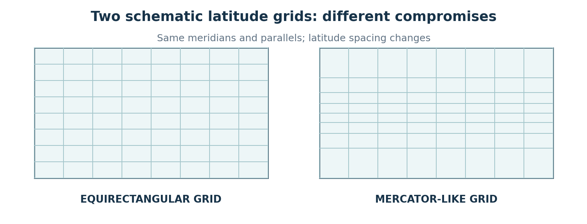

Imagine peeling the skin from an orange and pressing it flat without stretching or tearing it. You cannot. A sphere-like surface cannot be flattened without distortion; cartographers face the same problem with Earth. A <strong>map projection</strong> is a mathematical rule that places positions on a curved surface onto a flat sheet or screen. Different projections preserve different properties. The choice is not just aesthetic: it affects what comparisons viewers find intuitive.

A familiar cylindrical <strong>Mercator projection</strong> is <em>conformal</em>: at sufficiently small scales, it preserves local angles and shapes. On it, a line of constant compass bearing—a <strong>rhumb line</strong>—appears straight, a useful property in traditional navigation. But the projection magnifies areas increasingly as you move toward high latitudes. Greenland can appear immense compared with Africa, although Africa's actual area is approximately fourteen times Greenland's. The geographic fact did not change; the drawing rule did. The poles themselves cannot be shown at finite positions on a standard Mercator map. \[<a href="/005-geography-maps-and-scale/sources/#source-1" class="cite">1</a>\]

An <strong>equal-area projection</strong> makes a different promise: equal surface areas on Earth occupy equal areas on the map. It sacrifices some shapes and angles to accomplish this. A globe best represents the whole planet's relative shapes and areas, but a globe cannot easily show every location at once. A <strong>compromise projection</strong>, such as Robinson or Winkel Tripel, attempts to balance distortions without perfectly preserving any single property worldwide. An <strong>azimuthal</strong> projection may preserve directions from its centre; particular <strong>equidistant</strong> projections preserve distances along specific lines, not all possible routes. The question is never “Which map is perfect?” but “Which map is suitable for my task?” \[<a href="/005-geography-maps-and-scale/sources/#source-1" class="cite">1</a>\]\[<a href="/005-geography-maps-and-scale/sources/#source-2" class="cite">2</a>\]

<figure class="figure" id="figure-5-2">

<figcaption>Figure 5.2. Two schematic latitude grids illustrating why a flat map must choose its distortions. <a class="figure-anchor" href="#figure-5-2" aria-label="Link to this figure">#</a></figcaption>
</figure>

A practical misconception is that a straight line on your ordinary world map is always the shortest route. On a globe, a shortest surface path follows a <strong>great-circle route</strong>. When aircraft cross the northern Atlantic, their curved-looking paths on a flat map can be shorter than a visually straight route. Meanwhile, the straight rhumb line of a Mercator map holds a constant bearing but usually is not the shortest path except in particular cases. Even modern routes may deviate from great circles because of winds, restricted airspace, safety, weather, costs, and airport constraints.

Projection is not the only choice hiding inside a map. The cartographer also selects a <strong>centre</strong>, <strong>orientation</strong>, <strong>scale</strong>, <strong>date</strong>, <strong>classification</strong>, <strong>legend</strong>, and <strong>which information to leave out</strong>. A north-up map is a convention, not a law of nature. A map centred on the Atlantic makes Europe and the Americas appear prominent; a Pacific-centred map highlights Asia-Oceania connections. A political map emphasizes states; a relief map emphasizes elevation; a transit map may deliberately distort distances so that stations and interchanges remain readable.

Cartographic literacy requires a gentle suspicion: <em>what was this map built to show, what does it hide, and could a different projection or framing change the reader's impression?</em> A map can be accurate for its purpose without being a neutral picture of everything.
