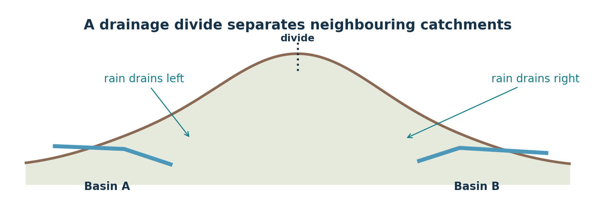

From space, river systems look like branching networks. Rain or snowmelt gathers into channels, flows downhill under gravity, joins tributaries, and often reaches a lake or sea. The area that drains toward a common outlet is a <strong>watershed</strong>, also called a drainage basin or catchment. A <strong>drainage divide</strong> separates neighbouring basins, often along higher ridges. The ridge separating two valleys can therefore decide which river eventually receives their rainfall.

<figure class="figure" id="figure-5-5">

<figcaption>Figure 5.5. Rain falling on opposite sides of a drainage divide can enter different catchments. <a class="figure-anchor" href="#figure-5-5" aria-label="Link to this figure">#</a></figcaption>
</figure>

Water shapes landscapes by <strong>erosion</strong> (removing material), <strong>transport</strong> (carrying it), and <strong>deposition</strong> (laying it down). Fast-moving water may erode valleys; slower sections can deposit sediment. A river can build a floodplain of fertile sediments, but the same plain is exposed to flooding. A delta forms where sediment accumulates near a river's mouth under suitable conditions. Not every river forms a large delta: waves, currents, sediment supply, sea-level conditions, human dams, and other factors can prevent or reshape deposition.

Rivers have mattered to human societies because they provide water, fertile floodplains, fishing, transport corridors, and sometimes power. The Nile's seasonal flood regime helped sustain historical agriculture, though people also needed labour organization, storage, irrigation and political institutions. The Ganges-Brahmaputra-Meghna system shapes life across South Asia through water, fertile sediments and flood risks. The Danube links numerous central and southeastern European landscapes before reaching the Black Sea. The Amazon's immense basin supports a vast ecological system whose forests, soils, waters and communities are deeply interconnected.

A river is not automatically an easy highway. Rapids, seasonal changes, waterfalls, shallow reaches, and changing channels can obstruct transport. Boats may move differently upstream and downstream. Bridges and navigable channels require investment. A river may link markets in one century and lose relative transport importance after railway construction, while still providing drinking water, irrigation and ecological services.

Water creates political questions because basins and states rarely line up perfectly. <strong>Upstream</strong> users and <strong>downstream</strong> users may have different concerns about dams, irrigation, pollution, hydropower, and drought. Every party has legitimate needs that cannot be understood by looking only at the river's route. Consider the Nile system: its waters cross several countries and climates, and decisions about water use involve hydrology, population, history, infrastructure, and diplomacy. Geography explains interdependence; it does not dictate a fair political settlement.

Groundwater matters as much as visible rivers in many regions. Water held in pores and fractures beneath the surface may supply wells and agriculture. An <strong>aquifer</strong> is a geological formation capable of storing and transmitting usable groundwater. Some aquifers recharge slowly; extracting more than the replenishment rate can lower water tables. Pumping may enable farming in a dry region while creating long-term costs for neighbouring communities and later generations. The map of rivers is therefore only part of a territory's water geography.
