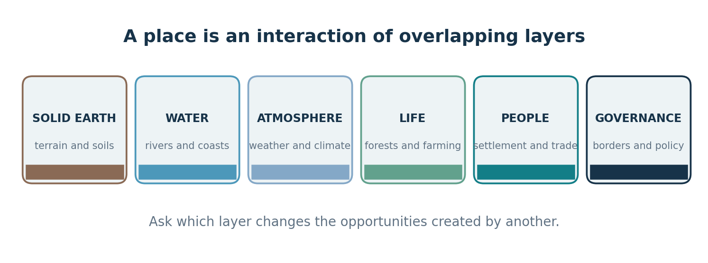

<strong>Physical geography</strong> examines landforms, water, climate, soils, ecosystems, and the processes that create and change them. <strong>Human geography</strong> examines settlements, populations, migration, language, economic activity, political territories, and the routes through which societies exchange goods and ideas. Neither can be understood fully in isolation. A river is a hydrological system, an ecological habitat, a source of drinking water, a transport corridor, and sometimes a legal border. One feature can be studied through several lenses, each revealing a different kind of fact.

Geographers also distinguish <strong>space</strong> from <strong>place</strong>. Space helps us describe distance, distribution and relationships among locations. Place adds the particular characteristics and human meanings attached to a location: a familiar mountain valley, a sacred city, a manufacturing centre, or a frontier. The same village can be a place of memory for its residents and a point in a regional population dataset. Both descriptions are valid for different questions, but the second is not a substitute for the first.

A key word is <strong>scale</strong>. At the scale of a street, a new pedestrian crossing may change how people reach a shop. At the scale of a country, rail networks may influence which regions attract investment. At the scale of a continent, rainfall belts and mountain systems help explain broad patterns of agriculture. At the planetary scale, the oceans regulate enormous flows of heat and moisture. A generalization that works at one scale may break down at another. Saying “the Mediterranean has dry summers” can describe a broad climatic pattern without implying that every valley and hill experiences identical weather.

Geography also studies <strong>change over time</strong>. River channels migrate; coastlines erode; climates fluctuate; cities expand; political borders are negotiated. A map is a picture from a particular moment, built from observations and conventions. It cannot contain all possible futures. An elegant atlas page can invite the wrong assumption that the world has always looked this way.

The useful mental model is a stack of layers: geology, elevation, water, climate, vegetation, population, land use, transport networks, institutions. Ask how one layer changes the meaning of another. A flat plain might support mechanized farming where soils, water and property arrangements permit it. The same flatness could also make a site vulnerable to flooding. No geographical feature is simply an advantage or disadvantage outside a specific human question.

<figure class="figure" id="figure-5-1">

<figcaption>Figure 5.1. A geographical investigation moves through interconnected physical and human layers. <a class="figure-anchor" href="#figure-5-1" aria-label="Link to this figure">#</a></figcaption>
</figure>
