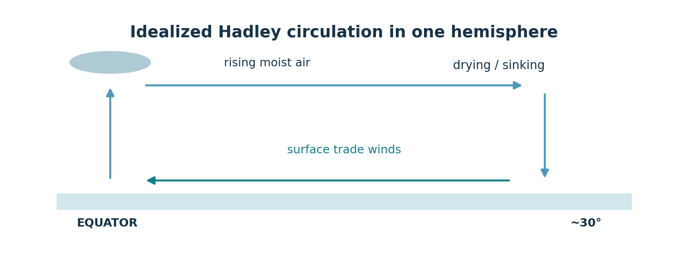
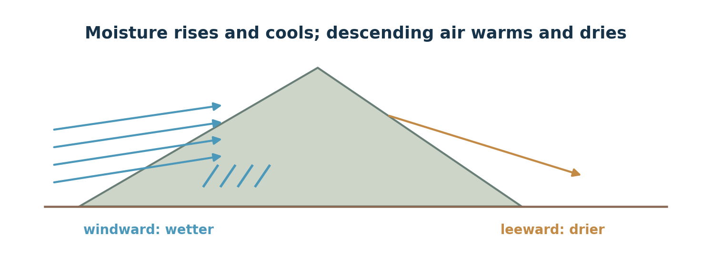

Earth is not heated evenly. Because of its curved shape and axial tilt, the angle and duration of sunlight vary by latitude and season. In broad terms, equatorial regions receive more direct solar energy over the year, while high latitudes have much larger seasonal differences in daylight. The seasons are caused primarily by the <strong>tilt of Earth's axis</strong> relative to its orbit, not by Earth being substantially nearer the Sun in northern summer. The two hemispheres experience opposite seasonal phases.

<strong>Weather</strong> is the short-term state of the atmosphere: today's temperature, cloud, rain, wind, and pressure. <strong>Climate</strong> is the statistical pattern and range of weather over longer periods, often summarized using multi-decade averages while also studying extremes. A cold Tuesday does not disprove a long-term warming trend, and a hot week alone does not establish one. The distinction is between a particular event and a distribution of events across time.

Near the Equator, warm moist air often rises in zones of low pressure, cools and produces substantial rainfall. At higher levels, some of that air moves poleward, eventually descending in subtropical regions. This idealized tropical circulation is called the <strong>Hadley cell</strong>. Combined with global circulation, Earth's rotation, land-sea differences and ocean circulation, it helps explain why many equatorial regions are humid and many subtropical regions have dry climates. The actual atmosphere is far messier than a neat diagram; rain belts shift with the seasons and local geography matters. \[<a href="/005-geography-maps-and-scale/sources/#source-4" class="cite">4</a>\]

<figure class="figure" id="figure-5-6">

<figcaption>Figure 5.6. Simplified Hadley-cell circulation. Actual global atmospheric flows are more complex. <a class="figure-anchor" href="#figure-5-6" aria-label="Link to this figure">#</a></figcaption>
</figure>

A <strong>monsoon</strong> is fundamentally a seasonal reversal or major seasonal shift in atmospheric circulation, often producing a strong wet-dry seasonal pattern. It is not simply a synonym for “heavy rain.” Southern and eastern Asia contain well-known monsoon systems, but monsoonal circulation affects other regions too. Land and ocean heat at different rates, and large-scale atmospheric patterns move seasonally. Agricultural calendars, reservoirs, flood planning and urban drainage all depend on these recurring patterns.

Mountains add the <strong>rain-shadow effect</strong>. Moist air approaching a range may rise, cool, and condense, producing precipitation on a windward slope. Air descending on the leeward side tends to warm and become drier in relative terms. The outcome depends on winds, temperature, slope, moisture supply and weather patterns; not every mountain produces an equally strong rain shadow. Mountain ranges can thus place relatively wet and dry environments quite close together.

<figure class="figure" id="figure-5-7">

<figcaption>Figure 5.7. A conceptual rain-shadow mechanism across a mountain barrier. <a class="figure-anchor" href="#figure-5-7" aria-label="Link to this figure">#</a></figcaption>
</figure>

<strong>Altitude</strong> can make a high tropical city cooler than a coastal lowland at similar latitude. <strong>Continentality</strong> distinguishes areas moderated by nearby large bodies of water from continental interiors with larger seasonal temperature ranges. Large lakes can also moderate local climate. Ocean currents transport heat, influence sea-surface temperatures, and can affect fog, rainfall and marine ecosystems. The Gulf Stream and broader North Atlantic circulation contribute to the North Atlantic's climatic pattern; a precise city's climate also depends on winds, its latitude, elevation, and land-sea geometry. \[<a href="/005-geography-maps-and-scale/sources/#source-5" class="cite">5</a>\]

Climatic categories, including tropical, arid, temperate, continental, and polar groups, are useful summaries rather than rigid boxes. A transition zone may shift across a few dozen kilometres or with altitude. And climate itself can change over centuries or decades. Understanding a place requires both its long-standing climatic tendencies and the pressures that are currently altering them.
