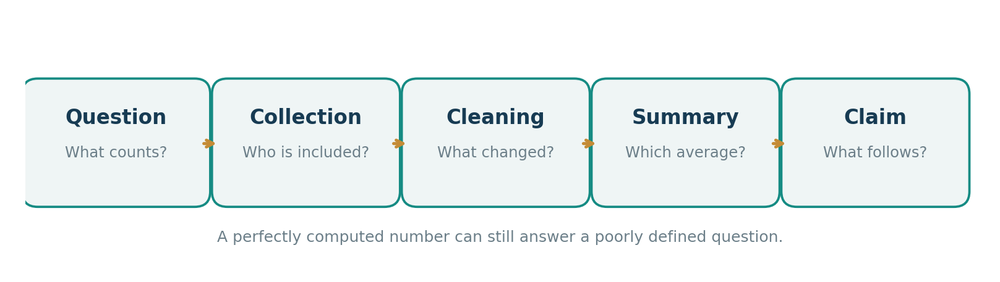

Consider the statement, “The average shop sells 200 items a day.” Before asking whether 200 is accurate, ask: what counts as a shop, an item and a day? Does a single packet of biscuits count as one item, or is it part of a multipack? Are closed Sundays included? Are shops equally weighted regardless of size? Does the figure mean the mean of individual shop averages, or total items sold divided by all shop-days? The answers may change the result dramatically without changing a single original transaction.

A <strong>unit of observation</strong> is the thing represented by one row of data: one customer, household, purchase, country, school, or day. A <strong>variable</strong> is a characteristic observed for that unit: its price, income, test score, date, or category. A <strong>population</strong> is the complete group about which a question is asked. A <strong>sample</strong> is the subset actually observed. A <strong>parameter</strong> describes the population, while a <strong>statistic</strong> summarizes the sample. These distinctions may sound abstract until a customer satisfaction survey of 50 visitors is advertised as the view of an entire town.

Not all data have the same structure. <strong>Categorical data</strong> place observations into groups, such as payment method or preferred transport. <strong>Numerical data</strong> record quantities, such as journey time or kilograms sold. Some quantities are counts; others are measurements on a continuum. Ordinal categories have an order—very dissatisfied, dissatisfied, neutral, satisfied, very satisfied—but the gaps between them need not be equal. Replacing those answers with the numbers 1–5 makes calculations convenient; it does not magically prove that the psychological distance from 1 to 2 equals that from 4 to 5.

The definition matters most when data will guide a decision. A government evaluating “employment” needs a consistent definition of who is counted as working. A school monitoring “attendance” must decide whether a student who arrives late counts as present. A retailer investigating “profit” must distinguish revenue, gross margin, operating profit, and cash. These are not merely technical details below the headline. They determine what the headline is about.

<figure class="figure" id="figure-6-1">

<figcaption>Figure 6.1. The journey from an observation to a headline contains decisions at every stage. <a class="figure-anchor" href="#figure-6-1" aria-label="Link to this figure">#</a></figcaption>
</figure>
