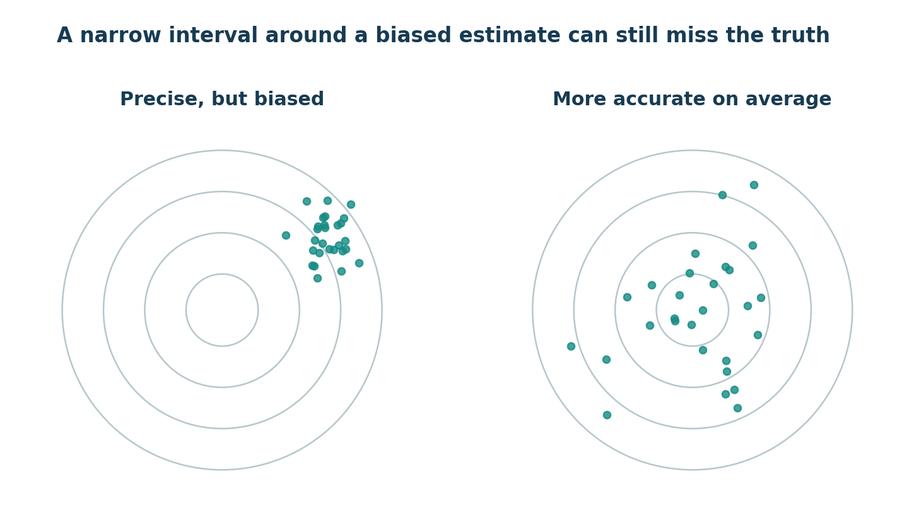

Suppose you draw a simple random sample of 400 voters from a large population and find that 50 percent support a proposal. An approximate standard error for a proportion is the square root of p(1−p)/n. With p = 0.50 and n = 400, that is 0.025. An approximate 95 percent interval using 1.96 standard errors is therefore 0.50 ± 0.049, or about 45.1 percent to 54.9 percent. This calculation assumes conditions where the normal approximation is suitable and does not account for coverage problems, nonresponse, question wording, clustering or other design effects.

If you quadruple the simple random sample size to 1,600 under comparable conditions, the approximate margin shrinks by half, to 2.45 percentage points. This <strong>square-root rule</strong> is a valuable reality check: doubling sample size improves random precision, but it does not halve the margin. An apparently enormous survey may still be biased if the wrong people were eligible or willing to answer.

The frequentist <strong>95 percent confidence interval</strong> is frequently misdescribed. After the interval has been computed under a fixed model, the unknown population parameter is treated as fixed, not a randomly moving number. The 95 percent refers to the long-run performance of the interval-building <em>procedure</em>: across repetitions, approximately 95 percent of such intervals would contain the true parameter if assumptions hold. It does not strictly mean that the parameter has a 95 percent probability of lying inside this particular computed interval. Bayesian methods can answer differently framed probability questions about parameters, but require explicit prior and model assumptions.

An interval is not a cure for faulty data. A narrow range around an estimate from a selectively recruited sample may create a dangerous illusion of certainty. In statistical work, <strong>accuracy</strong> and <strong>precision</strong> are different virtues. A dartboard analogy is useful: a tight cluster of darts can sit far from the bullseye. If the sampling process is biased, collecting more darts in the same wrong corner does not improve accuracy.

<figure class="figure" id="figure-6-7">

<figcaption>Figure 6.7. A conceptual depiction of precision versus accuracy; low variability is not sufficient if estimates are systematically biased. <a class="figure-anchor" href="#figure-6-7" aria-label="Link to this figure">#</a></figcaption>
</figure>
