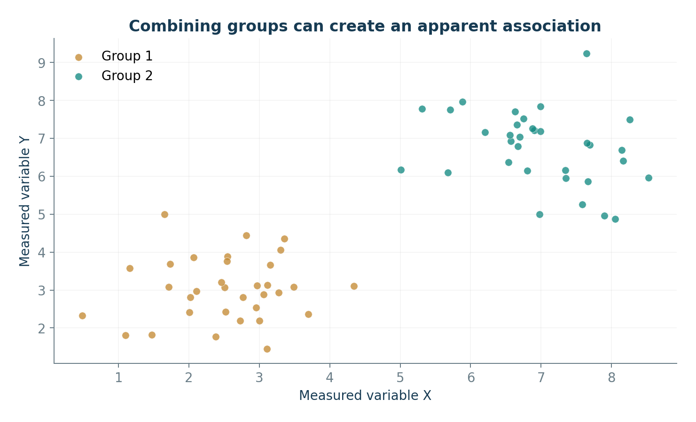

Suppose cities with more libraries also have higher average educational achievement. One explanation is that libraries help people learn. Another is that wealthier cities can afford more libraries and also tend to have educational advantages. Or both pathways may matter. The observed <strong>correlation</strong> tells us that two variables change together according to some pattern. It does not, by itself, identify the direction or source of causation.

A <strong>confounder</strong> influences both variables and creates or obscures an association. Ice-cream sales and swimming accidents may both rise in warm weather, but the weather and more time spent swimming offer an explanation that does not require ice cream to cause accidents. Beware of treating such examples as proof that every correlation is meaningless. An association can be a valuable clue, a predictive feature, or part of a causal chain; its interpretation depends on additional evidence.

The ordinary <strong>Pearson correlation coefficient</strong>, written <em>r</em>, ranges from −1 to +1 for a nondegenerate dataset. Values near +1 indicate a strong positive <em>linear</em> association, those near −1 a strong negative linear association, and values near zero little linear association. A curved relationship can be strong even if <em>r</em> is small. Outliers can influence <em>r</em> sharply. A correlation of +0.8 does not mean “80 percent of cases are explained” and it does not establish cause. In a simple linear-regression model with an intercept and one predictor, <em>r</em>² is the proportion of variation in the response accounted for by the fitted linear relationship in the sample; that is a narrower and more technical statement.

A <strong>scatterplot</strong> can expose features that one coefficient hides. Consider observations describing exercise time and resting pulse, or education and income. A few exceptional points, nonlinear curves, and separate clusters may all change the meaning. Asking to see the plot is often more useful than demanding another decimal place of <em>r</em>.

<figure class="figure" id="figure-6-5">

<figcaption>Figure 6.5. Two invented groups can show an overall pattern quite unlike the pattern within either group. <a class="figure-anchor" href="#figure-6-5" aria-label="Link to this figure">#</a></figcaption>
</figure>

Another danger is the <strong>ecological fallacy</strong>: assuming a group-level relationship applies to individual members. If regions with more university graduates vote differently, it does not follow that every graduate votes in the direction associated with those regions. Area-level data describe areas. Conclusions about individuals require suitable individual-level evidence. The issue appears in maps of crime, health, income and electoral behavior, where visually strong patterns can encourage unwarranted personal judgments.
